# Azure Multi-Region Disaster Recovery Lab with Terraform

**Status:** ✅ Complete. Deployed, tested, and failed over from West US 3 to Central US, then torn down to stop costs.

## Video Walkthrough

> 🎥 Loom walkthrough coming soon.

## Project Overview

I built a two-tier web application across two Azure regions, entirely in Terraform, to practice designing, deploying, and testing cross-region disaster recovery. West US 3 serves all traffic. Central US stays warm: its network, load balancer, and SQL server are always running, while the web VMs exist only as continuously replicated disks until a failover brings them online. Azure Front Door gives users one address and shifts traffic to whichever region is healthy.

The design changed as I built it. I started with three VMs per region, a management subnet with a self-hosted runner, and Ansible for configuration. I cut it to two VMs to reduce replication cost while keeping zone redundancy, replaced Ansible with cloud-init since stateless web VMs only need one-time setup, and removed the runner and its subnet. I also moved Front Door out of the global stack, because it needs both regions' load balancer IPs and has to deploy last.

The primary region changed during deployment too. I designed the lab around East US 2, but the first apply failed: my subscription couldn't create Azure SQL servers there, and the B-series VM size was out of capacity. I checked SQL and VM availability region by region, found West US 3 and Central US were the only regions where both worked, and moved the primary to West US 3 by renaming one stack and changing two variables. That move is in step 16.

How credentials are handled:

- **GitHub to Azure:** an app registration trusts GitHub through OIDC federated credentials, so no client secret exists anywhere.
- **Terraform state:** state lives in a geo-redundant, versioned storage account, accessed with Entra ID instead of storage keys.
- **Azure SQL:** Entra ID authentication only, so no SQL usernames or passwords exist.
- **VM access:** admins sign in with Entra ID through Azure Bastion. The SSH key exists only as a break-glass credential, and only its public half is in the repo.
- **Alert email:** kept in a gitignored `terraform.tfvars`, with a committed `.example` template.

### Skills Demonstrated

- **Multi-region architecture:** a warm standby region built from the same Terraform modules as the primary, with three inputs changed.
- **Disaster recovery services:** Azure Site Recovery replication and recovery plans, a SQL failover group, and Front Door priority routing with health probes.
- **Failover execution:** a full regional failover drill, with recovery time measured from Azure's job logs.
- **Network security:** least-privilege NSGs that override Azure's built-in allow-all-VNet rule, Bastion with no public IPs on VMs, and SQL reachable only through private endpoints.
- **Private DNS for PaaS:** a private DNS zone linked to both VNets, so the SQL name resolves to a private IP inside the network.
- **Terraform at scale:** seven reusable modules, four independently deployed stacks with separate state, and cross-stack outputs through `terraform_remote_state`.
- **Drift detection:** proved Terraform catches and reverses a manual security change.
- **Governance:** an enforced allowed-locations policy and an audit-only tag policy, assigned at a management group.
- **Observability:** diagnostic settings that discover each resource's log categories automatically, metric and KQL alerts, and an Action Group.
- **Troubleshooting under real constraints:** region restrictions, VM capacity, subscription limits, and Site Recovery limitations, each diagnosed and fixed in code.

## Architecture Diagram


## Prerequisites

- An Azure subscription where I have Owner. It must be **Pay-As-You-Go**, because Front Door is blocked on Free Trial subscriptions.
- Azure CLI, Terraform 1.6 or later, Git, VS Code
- macOS with zsh
- A GitHub account (a public repo makes rulesets free)
- At least 4 free vCPUs of the chosen VM family in both regions. Check region and size availability first:

```bash
az sql location-capability show --location westus3 --query status -o tsv
az vm list-skus --location westus3 --size Standard_D2s_v7 --all --query "[].restrictions" -o tsv
az vm list-usage --location westus3 --query "[?contains(name.value,'DSv7')]" -o table
```

## Naming Conventions

| Resource | Name |
|---|---|
| GitHub repository | `clevelandjosiah/two-tier-dr` |
| Regions | West US 3 (`wus3`), primary. Central US (`cus`), DR. |
| Resource groups | `rg-tfstate`, `rg-dr-global`, `rg-dr-wus3`, `rg-dr-cus` |
| State storage | `sttfstate<random>`, container `tfstate`, one key per stack |
| VNets | `vnet-dr-wus3` (`10.10.0.0/16`), `vnet-dr-cus` (`10.20.0.0/16`) |
| Subnets | `AzureBastionSubnet` (`x.x.0.0/26`), `snet-app` (`x.x.2.0/24`), `snet-data` (`x.x.3.0/24`) |
| NSGs | `nsg-app-<region>`, `nsg-data-<region>`, `nsg-bastion-<region>` |
| Web VMs | `vm-web-wus3-1` (zone 1), `vm-web-wus3-2` (zone 2), size `Standard_D2s_v7` |
| Failed-over VMs | `repl-web-zone1`, `repl-web-zone2` (named by Site Recovery) |
| Load balancers | `lb-dr-wus3`, `lb-dr-cus` |
| SQL | Servers `sql-dr-<region>-<random>`, database `sqldb-app`, failover group `fog-two-tier-dr-<random>` |
| Vaults | `rsv-backup-wus3` (Azure Backup), `rsv-asr-cus` (Site Recovery) |
| Recovery plan | `rp-web-wus3-to-cus` |
| Front Door | Profile `afd-two-tier-dr`, endpoint `two-tier-dr`, origins `primary-wus3` and `secondary-cus` |
| Monitoring | Workspace `law-dr-lab`, action group `ag-dr-lab` |
| Pipeline identity | App registration `gh-two-tier-dr` |
| Management group | `mg-dr-lab` |
| GitHub secrets | `AZURE_CLIENT_ID`, `AZURE_TENANT_ID`, `AZURE_SUBSCRIPTION_ID` |
| Pipeline file | `.github/workflows/ci.yml` |

## Project Steps

### 1. Create the repository

```bash
mkdir two-tier-dr && cd two-tier-dr
git init
gh repo create clevelandjosiah/two-tier-dr --public --source=. --remote=origin
```

I committed `.gitignore` before any Terraform existed, so state files, plan files, tfvars, and `.terraform/` provider folders could never reach GitHub. `.terraform.lock.hcl` is deliberately not ignored, because it pins provider versions. I built on a feature branch, then moved the work to `main` and paused the CI workflow by renaming it to `ci.yml.disabled`, so pushes to `main` couldn't trigger a deploy before the pipeline was verified against Azure.

### 2. Bootstrap Azure and GitHub

Some things have to exist before Terraform or the pipeline can run. I set these up once with the CLI.

**Resource providers.** Azure has to enable each service type on a subscription before it can be used:

```bash
for ns in Microsoft.Storage Microsoft.Network Microsoft.Compute Microsoft.Sql \
          Microsoft.RecoveryServices Microsoft.Cdn Microsoft.OperationalInsights Microsoft.Insights; do
  az provider register --namespace $ns
done
```

**Pipeline identity with OIDC.** Azure trusts tokens signed by GitHub, and each federated credential's `subject` decides which runs get in:

```bash
APP_ID=$(az ad app create --display-name gh-two-tier-dr --query appId -o tsv)
az ad sp create --id $APP_ID
az role assignment create --assignee $APP_ID --role Contributor --scope /subscriptions/$SUB_ID

for s in "ref:refs/heads/main" "pull_request"; do
  az ad app federated-credential create --id $APP_ID --parameters "{
    \"name\": \"gh-${s//[:\/]/-}\",
    \"issuer\": \"https://token.actions.githubusercontent.com\",
    \"subject\": \"repo:clevelandjosiah/two-tier-dr:$s\",
    \"audiences\": [\"api://AzureADTokenExchange\"]
  }"
done
```

**State backend.** Terraform can't store state in an account that doesn't exist yet, so [`bootstrap/create-tfstate.sh`](bootstrap/create-tfstate.sh) creates it. Every step checks before acting, so the script is safe to re-run.

```bash
./bootstrap/create-tfstate.sh
```

**Governance and VM access:**

```bash
az account management-group create --name mg-dr-lab --display-name "mg-dr-lab"
az account management-group subscription add --name mg-dr-lab --subscription $SUB_ID
az role assignment create --assignee $APP_ID --role "Resource Policy Contributor" \
  --scope /providers/Microsoft.Management/managementGroups/mg-dr-lab

ssh-keygen -t rsa -b 4096 -f ~/.ssh/two-tier-dr -N ""
cp ~/.ssh/two-tier-dr.pub terraform/keys/web.pub
```

What it creates:

- **Pipeline identity** `gh-two-tier-dr`, with federated credentials for `main` and for pull requests. No client secret is ever created.
- **State storage** in its own resource group in Central US, so tearing down the lab can never delete it and Terraform still works if the primary region is down:

| Setting | Value | Why |
|---|---|---|
| Replication | GRS | Copied to Central US's paired region |
| Versioning and soft delete | On, 30 days | A corrupted state file can be rolled back |
| Lock | `CanNotDelete` | Prevents accidental deletion |
| Access | Entra ID | No storage keys in the pipeline |

- **Management group** `mg-dr-lab`, holding my subscription.
- **A break-glass SSH key.** Azure requires one to create a Linux VM, even though day-to-day access uses Entra ID.
- **Permissions:**

| Principal | Role | Scope |
|---|---|---|
| Pipeline | Contributor | Subscription |
| Pipeline | Storage Blob Data Contributor | State storage account |
| Pipeline | Resource Policy Contributor | `mg-dr-lab` |
| Me | Storage Blob Data Contributor | State storage account |
| Me | Virtual Machine Administrator Login | Subscription |

Contributor can't assign policies or create role assignments, which is why the pipeline needs the separate policy role and why the role assignments themselves are created by hand.

### 3. Terraform layout

The code is split into [modules](terraform/modules/), which define what a piece of infrastructure looks like, and [stacks](terraform/stacks/), which call those modules with region-specific inputs and each own one state file:

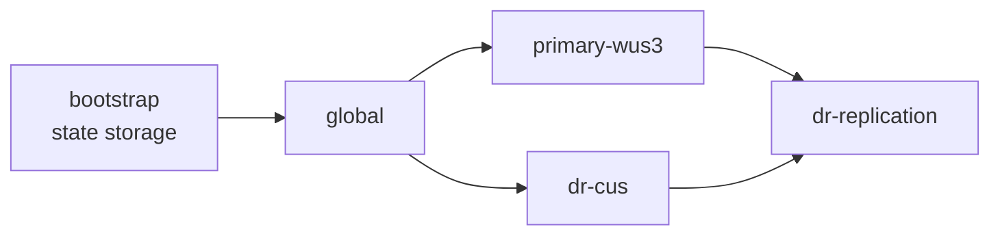

| Stack | State key | Contains |
|---|---|---|
| `global` | `two-tier-dr/global.tfstate` | Private DNS zone, Log Analytics, Azure Policy |
| `primary-wus3` | `two-tier-dr/primary-wus3.tfstate` | Network, compute, SQL, backup |
| `dr-cus` | `two-tier-dr/dr-cus.tfstate` | Network, idle load balancer, SQL server |
| `dr-replication` | `two-tier-dr/dr-replication.tfstate` | Peering, SQL failover group, Site Recovery, Front Door, monitoring |

Each stack's backend uses Entra ID for state access:

```hcl
terraform {
  backend "azurerm" {
    resource_group_name  = "rg-tfstate"
    storage_account_name = "sttfstate<random>"
    container_name       = "tfstate"
    key                  = "two-tier-dr/primary-wus3.tfstate"
    use_azuread_auth     = true
  }
}
```

Separate state means a failed apply in one stack can't damage another. The trade-off is ordering: `dr-replication` reads the regional stacks' outputs, so it can't even be planned until they are applied.

### 4. Global stack

[`terraform/stacks/global`](terraform/stacks/global) holds what both regions share. Its resource group lives in Central US, so none of it depends on the primary region.

| Resource | Why |
|---|---|
| Private DNS zone `privatelink.database.windows.net` | Both SQL private endpoints register their records here |
| Log Analytics workspace `law-dr-lab` | Central logs that survive a primary outage |
| Allowed locations policy, enforced | Blocks resources outside `westus3` and `centralus` |
| Required `project` tag policy, audit only | Reports untagged resources without blocking them |

```hcl
resource "azurerm_management_group_policy_assignment" "require_project_tag" {
  name                 = "require-project-tag"
  management_group_id  = data.azurerm_management_group.lab.id
  policy_definition_id = "/providers/Microsoft.Authorization/policyDefinitions/871b6d14-10aa-478d-b590-94f262ecfa99"
  enforce              = false
}
```

The tag policy only audits on purpose. Site Recovery and private endpoints create resources behind the scenes without my tags, so an enforced tag policy could block my own failover in the middle of an outage.

When the primary moved regions, the allowed-locations policy had to change first. Otherwise my own policy would have denied every West US 3 resource.

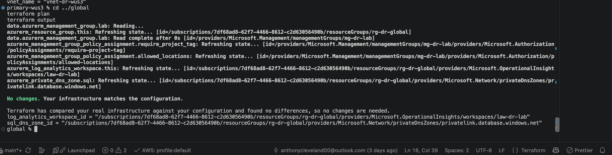

### 5. Network module

[`terraform/modules/network`](terraform/modules/network) builds a full region from one address range, using `cidrsubnet` to carve out every subnet.

Every NSG has a built-in rule at priority 65000, `AllowVnetInBound`, that lets anything in the VNet reach anything else on any port. An allow rule on its own changes nothing, since that traffic was already allowed. A boundary only exists once there's a deny, so every NSG ends with one:

```hcl
security_rule {
  name                       = "DenyVnetInbound"
  priority                   = 4000
  direction                  = "Inbound"
  access                     = "Deny"
  protocol                   = "*"
  source_port_range          = "*"
  destination_port_range     = "*"
  source_address_prefix      = "VirtualNetwork"
  destination_address_prefix = "VirtualNetwork"
}
```

| NSG | Allows | Then |
|---|---|---|
| `nsg-app` | HTTP from `AzureFrontDoor.Backend`, probes from `AzureLoadBalancer`, SSH from Bastion, SQL out to the data subnets | Denies all other VNet traffic, inbound and outbound |
| `nsg-data` | SQL (1433) from the app subnets in either region | Denies all other VNet traffic |
| `nsg-bastion` | Azure's required Bastion rule set | Missing any rule fails the Bastion deployment |

Default outbound access is disabled on the private subnets, so the NAT gateway is the only way out. That matters for Site Recovery: each VM's replication agent sends disk writes to a cache storage account through its public endpoint, and the NAT gateway is the only path there.

### 6. Compute module

[`terraform/modules/compute`](terraform/modules/compute) creates one load balancer per region and one web VM per availability zone it's given:

```hcl
resource "azurerm_linux_virtual_machine" "web" {
  for_each             = toset(var.zones)
  zone                 = each.key
  size                 = var.vm_size # Standard_D2s_v7
  disk_controller_type = "NVMe"      # required for v6 and newer sizes
  # ...
}
```

The primary passes `zones = ["1", "2"]`. The DR region passes `zones = []`, which creates the load balancer with an empty backend pool for Site Recovery to fill during a failover. `for_each` tracks each VM by its zone, so removing one zone never forces the others to be rebuilt.

Each VM runs cloud-init on first boot, which installs Nginx and writes a page naming the VM and region that served it. That page is how failover becomes visible: refresh, and the region changes. Each VM also gets a system-assigned managed identity and the `AADSSHLoginForLinux` extension for Entra ID sign-in.

### 7. SQL module

[`terraform/modules/sql`](terraform/modules/sql) creates an Azure SQL logical server and database. The server isn't a VM: it's Azure's container for the connection name, login rules, and network settings. The database is the data and the compute that runs queries.

Azure SQL lives on Microsoft's platform, outside my VNet. A private endpoint brings a doorway to it into the data subnet, with a private IP from that subnet's range, and writes its own DNS record:

```hcl
private_dns_zone_group {
  name                 = "default"
  private_dns_zone_ids = [var.dns_zone_id]
}
```

When the app looks up the SQL name, Azure DNS redirects it to the `privatelink` name, and the private DNS zone, linked to the VNet, returns the private IP. Lookups from outside a linked VNet get the public IP instead, which is blocked because `public_network_access_enabled = false`.

### 8. Backup module

[`terraform/modules/backup`](terraform/modules/backup) protects the primary VMs with daily backups:

| Setting | Value | Why |
|---|---|---|
| Vault location | West US 3 | A backup vault must be in the same region as the VMs it protects |
| Storage | Geo-redundant, Cross Region Restore on | Backups can be restored in West US 3's paired region, East US |
| Policy | Daily, 7-day retention, 2-day instant restore | Recent snapshots stay local for fast restores |
| Soft delete | On, enforced by Azure | New vaults can no longer turn it off. See step 16. |

Backup isn't the failover path. Site Recovery copies every disk write within minutes, which means it also copies deletions, corruption, and ransomware. Backups keep clean copies from before the damage.

Cross Region Restore always targets the **paired** region, which for West US 3 is East US, not my DR region. Restoring a backup into Central US would mean restoring into East US first.

### 9. DR region stack

[`terraform/stacks/dr-cus`](terraform/stacks/dr-cus) calls the same three modules as the primary with three changes:

```hcl
address_space   = "10.20.0.0/16" # must not overlap the primary, or peering fails
zones           = []             # Site Recovery creates the VMs
create_database = false          # the failover group creates the database
```

The result is a warm standby: the network, load balancer, and SQL server are ready, but the expensive parts only appear during a failover.

### 10. Replication stack

[`terraform/stacks/dr-replication`](terraform/stacks/dr-replication) reads both regions' outputs and connects them:

| Resource | Why |
|---|---|
| VNet peering, both directions | Lets the web tier reach either region's database after a SQL-only failover |
| SQL failover group, manual policy | Creates the secondary database, and gives the app one listener name that follows the primary |
| [Site Recovery module](terraform/modules/site-recovery) | Vault in Central US, cache account in West US 3, zone-to-zone replication, and a recovery plan for both VMs |
| [Front Door module](terraform/modules/front-door) | One public address with priority routing |

```hcl
resource "azurerm_cdn_frontdoor_origin" "primary" {
  host_name = var.primary_origin_ip
  priority  = 1 # preferred while healthy
}

resource "azurerm_cdn_frontdoor_origin" "secondary" {
  host_name = var.secondary_origin_ip
  priority  = 2 # used only when the primary fails health checks
}
```

Front Door only moves traffic. It can't bring the DR region online. Site Recovery and the SQL failover have to finish first, and that gap is the RTO.

### 11. Monitoring module

[`terraform/modules/monitoring`](terraform/modules/monitoring) runs from the replication stack, since that's the only stack that can see every resource. Instead of hardcoding log categories, it asks Azure which ones each resource supports:

```hcl
data "azurerm_monitor_diagnostic_categories" "this" {
  for_each    = var.diagnostic_targets
  resource_id = each.value
}
```

| Alert | Type | Fires when | Result |
|---|---|---|---|
| `alert-frontdoor-primary-down` | Metric | Origin health averages below 25% | ❌ False positive. See step 16. |
| `alert-lb-backend-unhealthy` | Metric | A primary web VM fails its health probe | Not evaluated separately |
| `alert-asr-replication-critical` | KQL | A replicated VM's health turns Critical | Did not fire. Replication stayed healthy. |

Alerts route to the `ag-dr-lab` Action Group. Everything lives in `rg-dr-global` in Central US, so losing the primary region doesn't take the alerting with it.

### 12. Pre-deployment checks

Before spending anything, I ran every check that doesn't create resources:

```bash
terraform fmt -check -recursive
for s in global primary-wus3 dr-cus dr-replication; do
  (cd stacks/$s && terraform init -input=false > /dev/null && terraform validate)
done
grep -rnE "sttfstateXXXXX|you@yourdomain.com|00000000-0000" stacks/ --include="*.tf"
```

| Check | Result |
|---|---|
| `terraform validate` | Caught two NSG attributes still using the singular `_prefix` with a list. Fixed. |
| Placeholders | None left |
| Global plan | No changes, confirming it was fully deployed |
| Primary plan | 39 to add, 0 to destroy, after fixing the state problem in step 16 |
| DR plan | 24 to add, 0 to destroy |
| vCPU quota | 4 per region. Quota alone wasn't enough: the size I planned on was restricted for my subscription. See step 16. |

### 13. Deploy the regions

```bash
cd terraform/stacks/primary-wus3
terraform plan -out=tfplan
terraform apply tfplan

cd ../dr-cus
terraform plan -out=tfplan
terraform apply tfplan

cd ../dr-replication
terraform plan -out=tfplan
terraform apply tfplan
```

The replication apply took about 40 minutes. Terraform waits for each VM's initial replication to finish, which copies every disk to Central US.

**Primary region.** Plan shows no changes after the apply, so the deployed state matches the code:

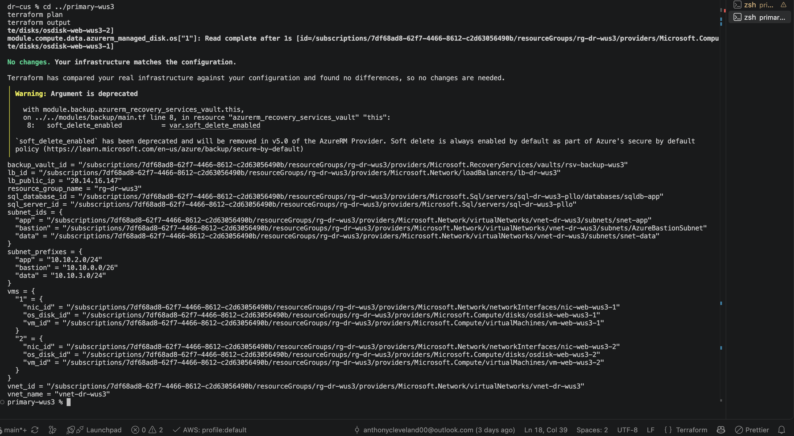

**DR region.** 24 resources: network, NAT gateway, idle load balancer, and SQL server:

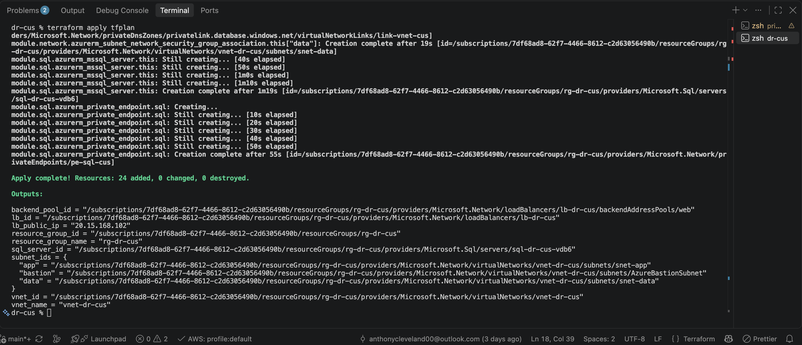

**Replication layer.** Peering, failover group, Site Recovery, Front Door, and monitoring:

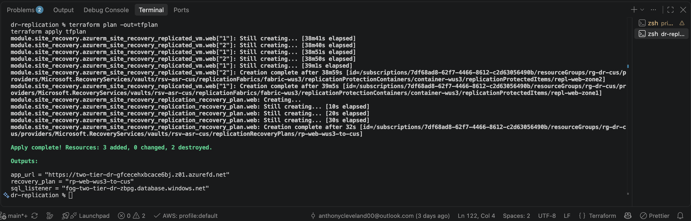

**The origins aren't public.** The app NSG only allows HTTP from Front Door's service tag, so hitting the load balancer directly times out:

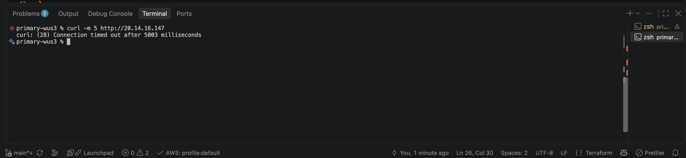

From inside each VM, Nginx answers:

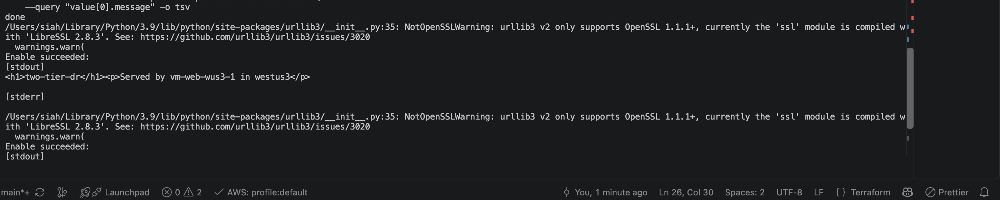

**Through Front Door.** The full path works: HTTPS at the edge, through the NSG, to the load balancer, to a zone-2 VM in West US 3:

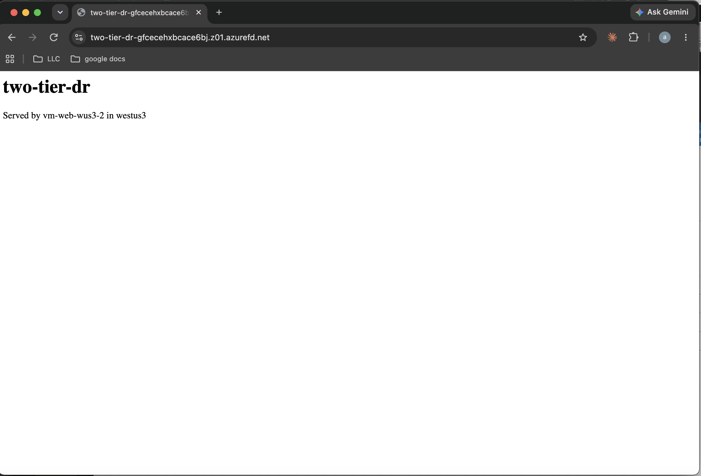

**Site Recovery.** Both VMs Protected, with healthy replication and failover health:


**SQL failover group.** West US 3 primary, Central US secondary, manual failover policy, one listener name:

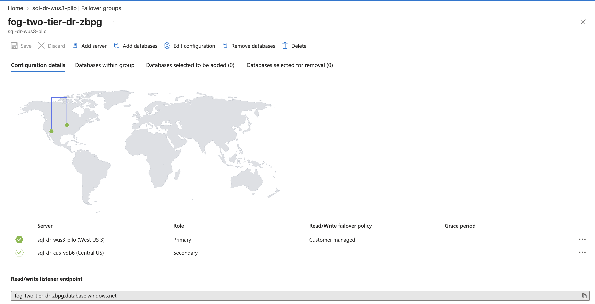

The database is online in West US 3 and readable in Central US, so data is replicating, not just paired:

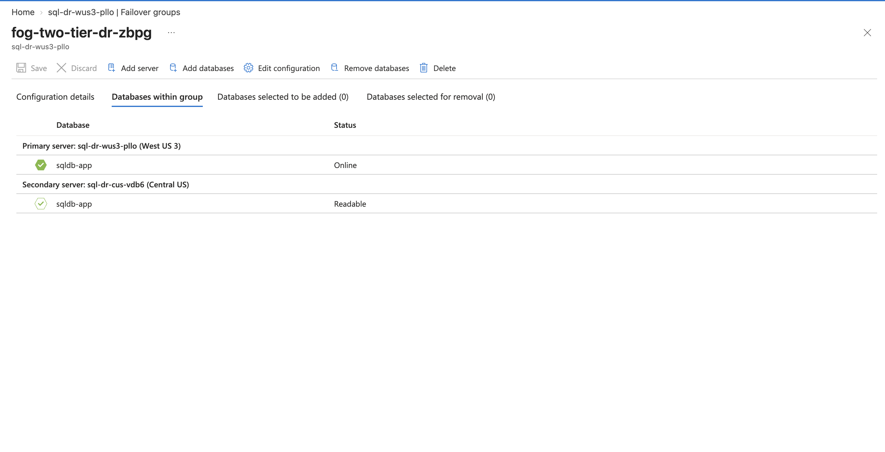

### 14. Prove it works

Each test tries to break a control. Full procedures are in [the lab guide](docs/LAB-GUIDE.md#phase-12-prove-it-works).

| Test | Expected | Result |
|---|---|---|
| VM1 calls VM2 on port 80 | Blocked | ✅ Blocked |
| Flip `DenyVnetInbound` to Allow outside Terraform | Connects | Still blocked. `DenyVnetOutbound` on the sender also stopped it. |
| Flip both deny rules to Allow | Connects | ✅ Connected |
| `terraform plan` detects the drift, `apply` reverses it | Blocked again | ✅ Detected and restored |
| SQL lookup from a VM | Resolves to `10.10.3.x` | ✅ `10.10.3.4` through `privatelink` |
| SQL from the internet | Denied | ✅ Public access off, SQL auth disabled |
| Deallocate one web VM | Site stays up | ✅ 6 of 6 requests served by the other zone |

**Lateral movement blocked.** VM1 can't reach VM2, even inside the same subnet:


**Simulated bad change.** One flipped rule wasn't enough. Lateral movement only opened after both the inbound and outbound deny rules were changed, so the design holds up against a single misconfiguration:


**Terraform catches the drift.** `plan` shows the rules being restored:


After `apply`, lateral movement is blocked again:

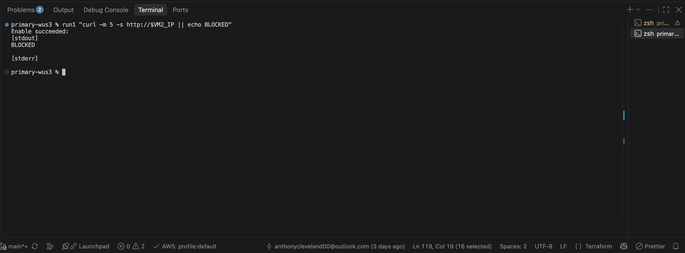

**SQL resolves privately.** From a VM, the SQL name resolves through `privatelink` to the private endpoint's IP in the data subnet:


**SQL refuses the internet.** The portal's query editor connects over the public endpoint and is refused. SQL authentication is also unavailable, since the server is Entra-only:


**Zone failure.** With VM1 deallocated, every request is served by VM2 in zone 2. This is high availability inside the region, not disaster recovery:


### 15. Failover drill

I simulated losing West US 3 and recovered in order: database, then compute, then traffic.

**1. Simulate the outage.** Deallocate both primary VMs. With no healthy origin, Front Door returns 504:

```bash
az vm deallocate -g rg-dr-wus3 -n vm-web-wus3-1 --no-wait
az vm deallocate -g rg-dr-wus3 -n vm-web-wus3-2
```

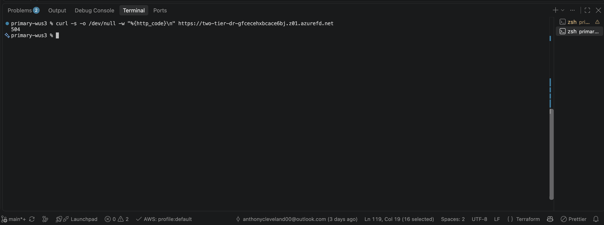

**2. Fail over SQL.** Run against the secondary server, since a failover is always requested from the side that's becoming primary:

```bash
az sql failover-group set-primary -g rg-dr-cus -s <DR SQL server> -n <failover group>
```

The listener name doesn't change, so the app's connection string doesn't either:


**3. Fail over compute.** Run the recovery plan from West US 3 to Central US with the latest processed recovery point. I left shutdown unchecked, since a region that's down can't shut anything down gracefully:

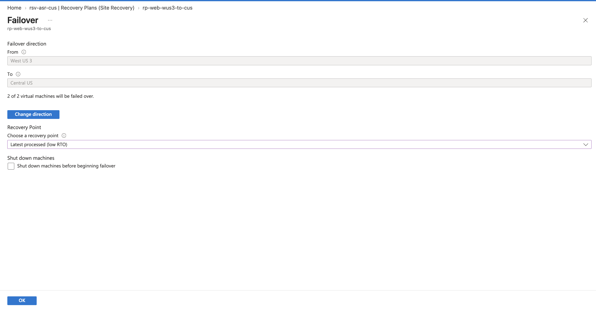

Site Recovery checked prerequisites, failed over both VMs, booted them, and finalized the plan in 3 minutes 52 seconds:

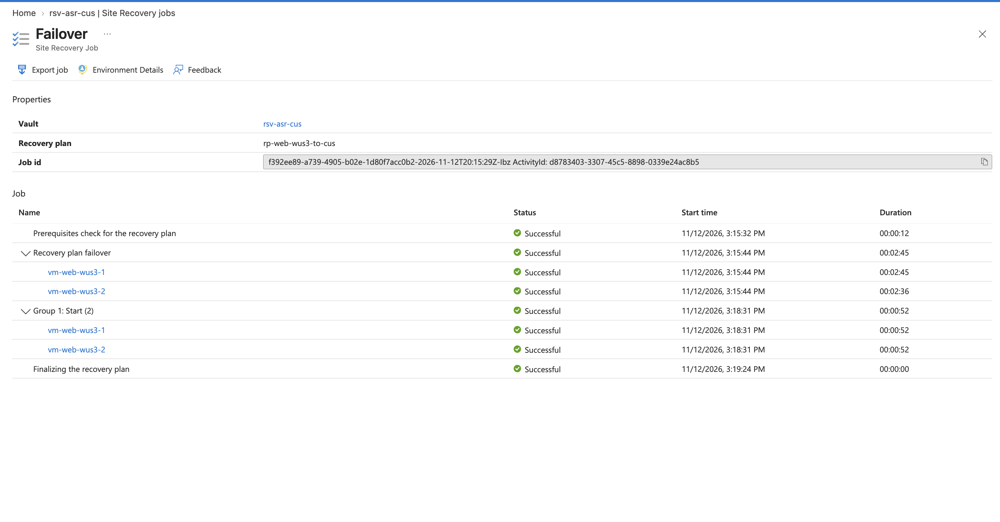

**4. Attach the recovered VMs to the DR load balancer.** Site Recovery can only attach recovered VMs to an internal load balancer, and Front Door needs a public one, so this step is manual:

```bash
for nic in $(az network nic list -g rg-dr-cus --query "[?virtualMachine!=null].name" -o tsv); do
  ipc=$(az network nic show -g rg-dr-cus -n $nic --query "ipConfigurations[0].name" -o tsv)
  az network nic ip-config address-pool add -g rg-dr-cus --nic-name $nic \
    --ip-config-name $ipc --lb-name lb-dr-cus --address-pool web
done
```

**5. Correct the page label.** cloud-init wrote the region into the page as fixed text when the VMs were built, so the recovered VMs still claimed `westus3`. I rewrote it from the Instance Metadata Service, which reports the real region. The permanent fix is in step 16.

**6. Verify.** Same URL, now served from Central US:


Front Door's origin request count shows traffic before the outage, nothing during it, and traffic again after recovery:

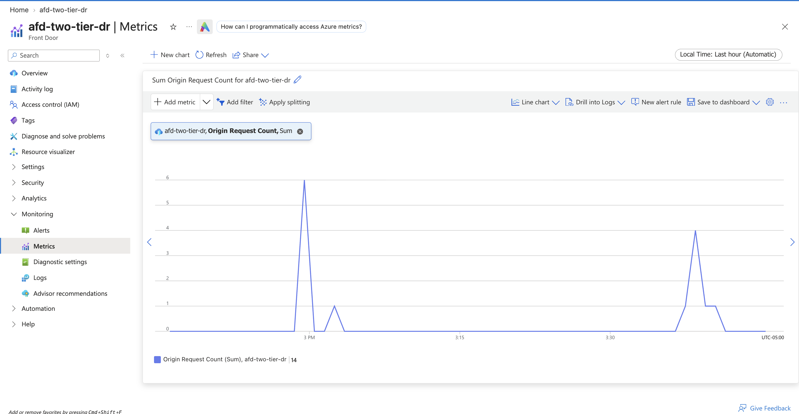

| Measure | Target | Result |
|---|---|---|
| Outage detected (Front Door 504) | n/a | 3:06 PM |
| SQL failover | 15 minutes | About 1 minute |
| Compute failover (Site Recovery job) | 30 minutes | 3 minutes 52 seconds |
| End-to-end, outage to site restored | 30 minutes | About 31 minutes, including manual steps |
| Web tier RPO | 5 minutes | Not measured. Used the latest processed recovery point. |

The 31 minutes is honest drill time, not automation time. Most of it was me working through manual steps: the SQL command, the portal, and the load balancer attachment. Automating step 4 inside the recovery plan would remove most of the gap.

**Alerting.** The Front Door alert fired, but at 12:13 PM, almost three hours before the outage. It was a false positive, covered in step 16:

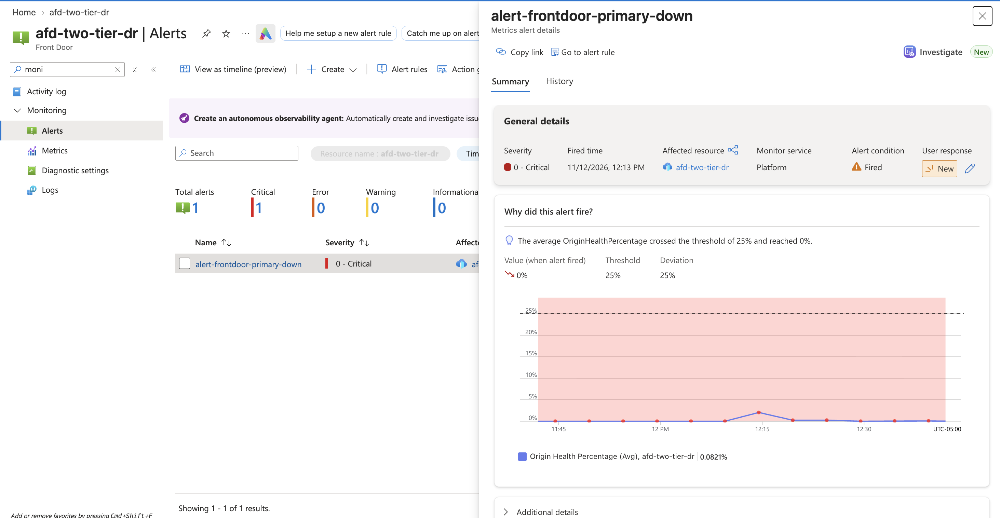

<!-- TODO: add once Outlook is back up -->
<!--  -->
> 📧 *Screenshot pending: the `ag-dr-lab` email for `alert-frontdoor-primary-down`. It shows the same 12:13 PM fire time, so it's part of the false-positive finding.*

I skipped failback. Reprotecting Central US back to West US 3 means another full replication cycle, and the lab was being destroyed right after.

### 16. Break and fix: what went wrong while building

**Before deployment**

1. **The storage account wouldn't create.** The bootstrap script failed with `SubscriptionNotFound`, even though the subscription was listed, enabled, and my default. The real cause was that the `Microsoft.Storage` resource provider wasn't registered. Registering it fixed the script, and I registered every provider the lab needs up front.
2. **GitHub secrets returned a 404.** `gh secret set` failed with `failed to fetch public key: HTTP 404` because the repository didn't exist on GitHub yet. Creating the repo first fixed it.
3. **One stack's state held another stack's resources.** The global stack's `backend.tf` was copied from the primary's, so the first global apply wrote into the **primary's** state file. When I corrected the key, `terraform init -migrate-state` copied the state to the new key but left the original behind. The primary plan then showed `2 to destroy` on a stack that had never been deployed. `terraform state show` confirmed the primary state held `rg-dr-global`, and applying would have destroyed the global resource group and DNS zone. I removed both entries with `terraform state rm`, which only edits Terraform's records, and the plan dropped to 0 to destroy while global still showed no changes.
4. **Validate caught a type error.** When I added cross-region SQL rules, I passed a list to `destination_address_prefix` and `source_address_prefix`, which only take a single string. The plural forms fixed it.
5. **The SSH key didn't exist.** `file()` failed on `keys/web.pub` because the key had never been generated on this machine.
6. **A stack referenced a missing module.** Adding the backup module failed with `Reference to undeclared module` because the stack had no `module "compute"` block to read `vm_ids` from.

**During deployment**

7. **East US 2 couldn't host the lab.** The first primary apply failed twice: `SkuNotAvailable` for `Standard_B2s`, and `ProvisioningDisabled` for Azure SQL. I checked SQL capability across seven regions, and only Central US and West US 3 allowed SQL servers. I destroyed the partial deployment, updated the allowed-locations policy, renamed the stack to `primary-wus3`, and changed `eastus2` to `westus3` throughout the code. Central US stayed the DR region, so the DR stack didn't change at all.
8. **Quota isn't the same as availability.** I had 4 B-series vCPUs of quota in both regions, but `az vm list-skus` showed `Standard_B2s` as `NotAvailableForSubscription` in both. I listed sizes with no restrictions in both regions and chose `Standard_D2s_v7`. Sizes from v6 onward need `disk_controller_type = "NVMe"`.
9. **A missing output broke the workflow.** `lb_public_ip` wasn't in the regional stacks' outputs, which Front Door reads through remote state. I added it to both and ran `terraform apply -refresh-only` to write it to state without changing resources.
10. **A hidden prompt held the state lock.** I piped `terraform plan` through `grep`, which hid an input prompt, so the plan hung while holding the state lock. The next plan failed with `state blob is already locked`. I released it with `terraform force-unlock` and stopped filtering plan output.
11. **Azure no longer lets you turn off soft delete.** Creating the Site Recovery vault failed: `soft_delete_enabled cannot be false`. Azure made soft delete mandatory on new Recovery Services vaults. I set it to `true`, and the provider now marks the argument as deprecated.
12. **Front Door is blocked on Free Trial.** `Free Trial and Student account is forbidden for Azure Frontdoor resources`. I upgraded the subscription to Pay-As-You-Go. The alternative was Traffic Manager, which would have meant exposing the origins to the internet.
13. **Site Recovery fabrics collided.** Terraform created both fabrics at once, and the API rejected the second with a misleading `resource already exists`. A listing showed only one fabric existed. Adding `depends_on` so they create one at a time fixed it.
14. **Site Recovery can't use a public load balancer.** Enabling replication failed with `The public load balancer 'lb-dr-cus' being used is unsupported`. Site Recovery only attaches recovered VMs to internal load balancers. I removed the setting and made it a post-failover step. In production, an Azure Automation runbook inside the recovery plan would do it automatically.

**During testing**

15. **The failover alert was broken from the start.** `alert-frontdoor-primary-down` fired at 12:13 PM, three hours before the outage. The metric it watched, origin health percentage, averaged under 2% even while both VMs were healthy, so a `< 25%` threshold was always true. An alert that's always firing teaches people to ignore it. The fix is to alert on Front Door's origin request count or 5xx rate instead, and to test every alert by triggering it on purpose before trusting it.
16. **Recovered VMs reported the wrong region.** cloud-init wrote the page using a Terraform variable, so after failover the Central US VMs still said `westus3`. The page is now corrected from the Instance Metadata Service, and the permanent fix is for cloud-init to read the region from it at boot. Site Recovery also names recovered VMs after their replicated items (`repl-web-zone1`), while the hostname inside the disk stays `vm-web-wus3-1`.

## Verification Checklist

- [x] All resource providers registered
- [x] Pipeline identity exists with federated credentials for `main` and pull requests
- [x] State storage is geo-redundant, versioned, soft-delete protected, and locked
- [x] Management group exists, and the pipeline has Resource Policy Contributor on it
- [x] Global stack deployed: DNS zone, Log Analytics, and both policy assignments
- [x] `terraform validate` passes for all four stacks
- [x] Primary and DR regions deployed
- [x] Both VMs show Protected in Site Recovery
- [x] Site reachable through Front Door from `westus3`
- [x] Origins unreachable directly from the internet
- [x] Lateral movement blocked, and drift restored by Terraform
- [x] SQL reachable only through the private endpoint
- [x] Site survives one deallocated VM
- [x] Regional failover completed, with RTO measured
- [ ] Web tier RPO measured
- [ ] Failback completed
- [ ] Front Door alert redesigned and tested
- [ ] Load balancer attachment automated in the recovery plan
- [ ] CI pipeline authenticates to Azure and runs a plan

## Troubleshooting

| Issue | Cause | Fix |
|---|---|---|
| `SubscriptionNotFound` creating the storage account, though the subscription was listed and enabled | `Microsoft.Storage` provider not registered | `az provider register --namespace Microsoft.Storage --wait` |
| `gh: command not found` | GitHub CLI not installed | Installed the GitHub CLI. Secrets can also be added in the browser. |
| `failed to fetch public key: HTTP 404` from `gh secret set` | The repo didn't exist on GitHub yet | Created the repo, then set the secrets |
| Terminal stuck at `quote>` after pasting | zsh doesn't treat `#` as a comment when pasting, so an apostrophe in a comment opened a quote | Ctrl+C, then pasted without comments |
| `Backend configuration changed` | `backend.tf` edited after the last `init` | `terraform init -migrate-state`, since the stack already had state |
| Primary plan showed `2 to destroy` before it was ever deployed | Primary's state still held global's resources after the backend key was changed | `terraform state rm` on both, then confirmed global still showed no changes |
| `Inappropriate value for attribute "destination_address_prefix": string required` | A list was passed to the singular attribute | Switched to `destination_address_prefixes` and `source_address_prefixes` |
| `no file exists at "./../../keys/web.pub"` | SSH key never generated on this machine | Generated the key pair and copied the public key into the repo |
| `Reference to undeclared module` | Stack referenced `module.compute`, but the block was missing | Added the `module "compute"` block |
| `terraform init` returned 403 on my laptop | Only the pipeline had data access to the state account | Granted myself Storage Blob Data Contributor |
| `SkuNotAvailable` for `Standard_B2s` | Size restricted for the subscription in that region | Listed unrestricted sizes in both regions and switched to `Standard_D2s_v7` |
| SQL server create failed with `ProvisioningDisabled` | Region closed to new SQL servers for the subscription | Checked `az sql location-capability show` per region and moved the primary to West US 3 |
| `git mv` failed with `bad source` | Ran from inside `terraform/`, then hit an untracked lock file | Ran from the repo root and removed `.terraform.lock.hcl` before moving |
| `Output "lb_public_ip" not found` | Output missing from the stack | Added it and ran `terraform apply -refresh-only` |
| `curl` to the load balancer hung | NSG only allows HTTP from Front Door | Expected. Tested from inside the VMs with `az vm run-command`. |
| `stat tfplan: no such file or directory` | The plan failed, and `grep` hid the error | Ran the plan without filtering |
| `state blob is already locked` | An earlier plan was stuck on a hidden prompt | `terraform force-unlock <lock id>` |
| `soft_delete_enabled cannot be false` | Azure now enforces soft delete on new vaults | Set `soft_delete_enabled = true` |
| `Free Trial and Student account is forbidden for Azure Frontdoor resources` | Subscription type | Upgraded to Pay-As-You-Go |
| `The resource already exists` on the second ASR fabric | Both fabrics created in parallel | `depends_on` between the fabrics |
| `The public load balancer 'lb-dr-cus' being used is unsupported` | Site Recovery only supports internal load balancers | Removed the setting and attached the VMs after failover |
| `FailoverGroupFailoverRequestOnPrimary` | The role changed while the request was in flight | Checked the partner's role. Failover had already completed. |
| `ResourceNotFound` for `vm-web-wus3-1` in `rg-dr-cus` | Site Recovery names recovered VMs after the replicated items | Listed VMs in Central US and used `repl-web-zone1` and `repl-web-zone2` |
| Origin health metric near 0% while healthy | The metric reads very low at this traffic level | Used origin request count to show the failover |

## Cleanup

Site Recovery and the failover group create resources Terraform doesn't track: the recovered VMs, their disks and NICs, and the database copy in Central US. These block a normal `terraform destroy` of the DR stack, so after a failover without failback I tore down in this order:

```bash
cd terraform/stacks/dr-replication && terraform destroy

az group delete -n rg-dr-cus --yes
cd ../dr-cus && terraform state list | xargs -n1 terraform state rm

cd ../primary-wus3 && terraform destroy
cd ../global && terraform destroy
```

Deleting `rg-dr-cus` directly removes everything in it, tracked or not. Clearing that stack's state afterward keeps Terraform from looking for resources that no longer exist.

To remove everything permanently, including the one-time setup:

```bash
SA=$(az storage account list -g rg-tfstate --query "[0].name" -o tsv)
az lock delete --name tfstate-cannot-delete -g rg-tfstate \
  --resource $SA --resource-type Microsoft.Storage/storageAccounts
az group delete --name rg-tfstate --yes

az account management-group subscription remove --name mg-dr-lab --subscription $SUB_ID
az account management-group delete --name mg-dr-lab

az ad app delete --id $(az ad app list --display-name gh-two-tier-dr --query "[0].appId" -o tsv)
```

The lock has to be removed before the state account can be deleted. Deleting the app registration also removes its federated credentials, and its role assignments stop applying. The GitHub secrets can stay, since they point at an identity that no longer exists.

## Key Takeaways

- **High availability and disaster recovery are different layers.** Zones survive a datacenter failure. Only a second region survives a regional one.
- **Check the region before writing the code.** Quota, VM size availability, and service availability are three different checks, and my original primary region failed two of them.
- **Modules made the region move cheap.** Moving the primary meant renaming one stack and changing a few values, because nothing region-specific lived in the modules.
- **Site Recovery copies mistakes.** It replicates corruption and ransomware within minutes, which is why backups are a separate layer and not the failover path.
- **Front Door only moves traffic.** RTO depends on how fast the replicas and the database fail over, not on routing.
- **Every manual step in a recovery plan costs minutes.** Site Recovery's own job took under 4 minutes. Most of the 31-minute drill was me.
- **An alert you haven't triggered is an assumption.** Mine fired constantly and would never have signaled the real outage.
- **Defense in depth works even inside one NSG.** Opening lateral movement took two bad changes, not one.
- **Governance can block recovery.** An enforced tag policy would deny the untagged resources Site Recovery creates during a failover.
- **State needs disaster recovery too.** If state lived in the primary region, Terraform would be locked out exactly when it's needed most.
- **Read every plan before applying.** A plan that destroys resources on a stack that was never deployed is a warning, not a formality.
- **`-migrate-state` copies, it doesn't move.** The old state stays behind, still claiming the resources.
- **Error messages can point the wrong way.** `SubscriptionNotFound` was really an unregistered resource provider, and `resource already exists` was really a race condition.
- **A PaaS database never lives in your network.** A private endpoint brings a private doorway to it instead.

---

Built by **Anthony Cleveland** · Cloud Engineer · [github.com/clevelandjosiah](https://github.com/clevelandjosiah)