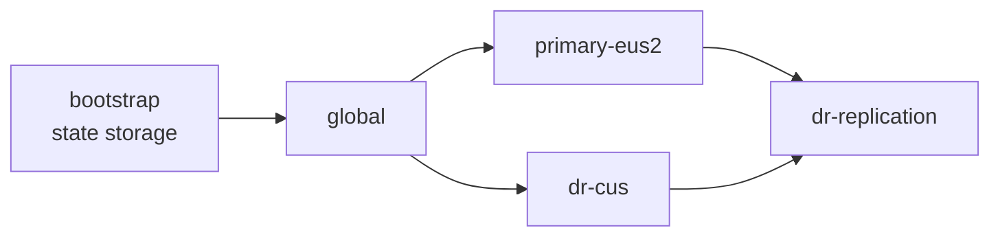
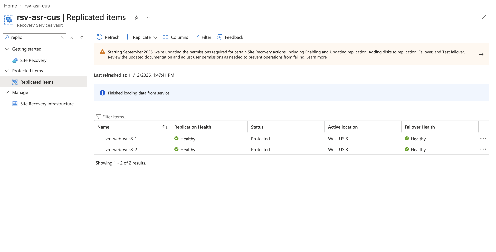
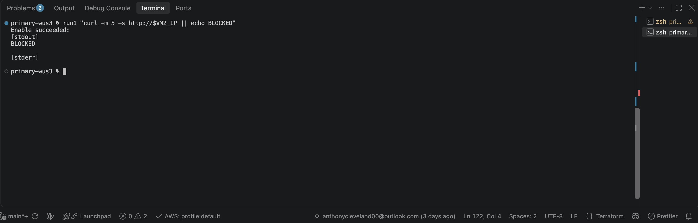
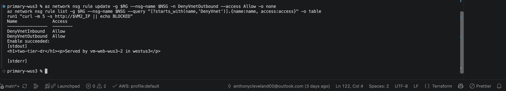
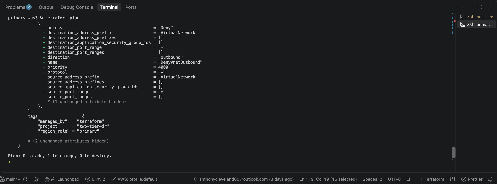
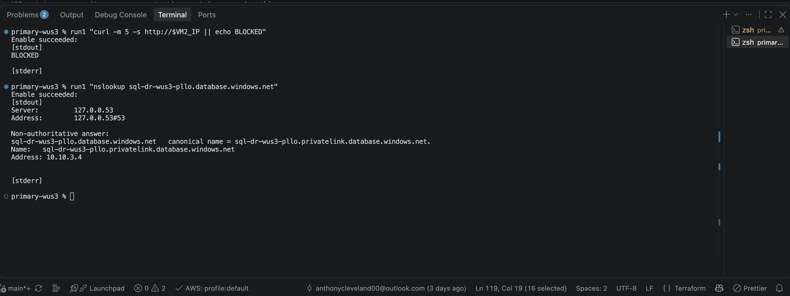
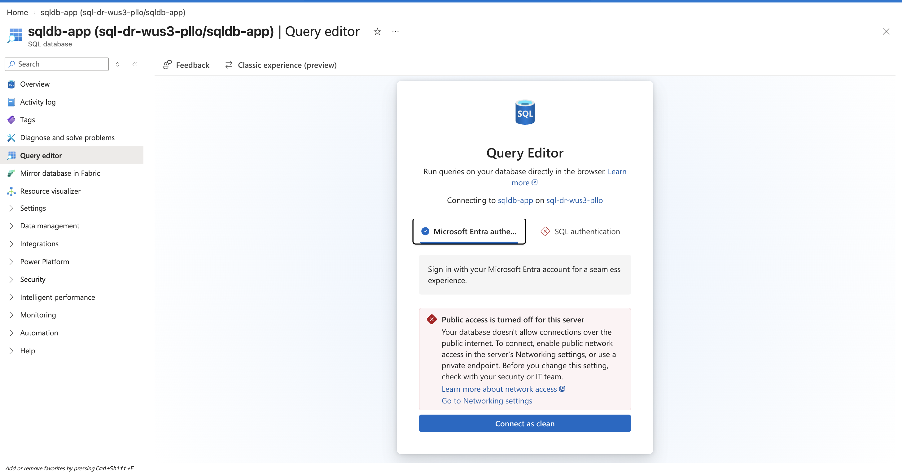
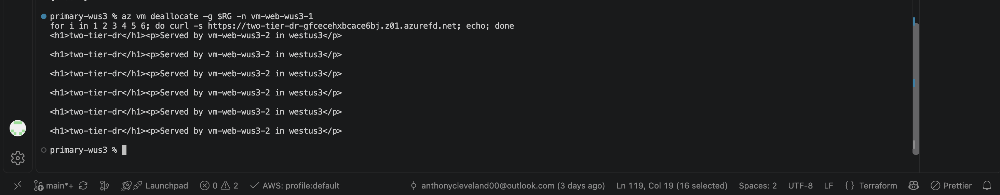
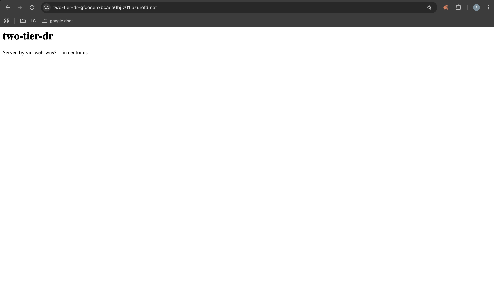

# Azure Multi-Region Disaster Recovery Lab with Terraform

**Status:** 🚧 In progress: code complete and validated, global stack deployed. Regional deployment, proof tests, and the failover drill are pending.

## Video Walkthrough

> 🎥 Loom walkthrough coming after the failover drill.

## Project Overview

I built a two-tier web application across two Azure regions, entirely in Terraform, to practice designing, deploying, and testing cross-region disaster recovery. East US 2 serves all traffic. Central US stays warm: its network, load balancer, and SQL server are always running, while the web VMs exist only as continuously replicated disks until a failover brings them online. Azure Front Door gives users one address and shifts traffic to whichever region is healthy.

The design changed as I built it. I started with three VMs per region, a management subnet with a self-hosted runner, and Ansible for configuration. I cut it to two VMs to reduce replication cost while keeping zone redundancy, replaced Ansible with cloud-init since stateless web VMs only need one-time setup, and removed the runner and its subnet. I also moved Front Door out of the global stack, because it needs both regions' load balancer IPs and has to deploy last.

How credentials are handled:

- **GitHub to Azure:** an app registration trusts GitHub through OIDC federated credentials, so no client secret exists anywhere.
- **Terraform state:** state lives in a geo-redundant, versioned storage account, accessed with Entra ID instead of storage keys.
- **Azure SQL:** Entra ID authentication only, so no SQL usernames or passwords exist.
- **VM access:** admins sign in with Entra ID through Azure Bastion. The SSH key exists only as a break-glass credential, and only its public half is in the repo.
- **Alert email:** kept in a gitignored `terraform.tfvars`, with a committed `.example` template.

### Skills Demonstrated

- **Multi-region architecture:** a warm standby region built from the same Terraform modules as the primary, with three inputs changed.
- **Disaster recovery services:** Azure Site Recovery replication and recovery plans, a SQL failover group, and Front Door priority routing with health probes.
- **Network security:** least-privilege NSGs that override Azure's built-in allow-all-VNet rule, Bastion with no public IPs on VMs, and SQL reachable only through private endpoints.
- **Private DNS for PaaS:** a private DNS zone linked to both VNets, so the SQL name resolves to a private IP inside the network.
- **Terraform at scale:** seven reusable modules, four independently deployed stacks with separate state, and cross-stack outputs through `terraform_remote_state`.
- **Governance:** an enforced allowed-locations policy and an audit-only tag policy, assigned at a management group.
- **Observability:** diagnostic settings that discover each resource's log categories automatically, metric and KQL alerts, and an Action Group.
- **State debugging:** found and fixed a stack whose state held another stack's resources before it could run a destructive plan.

## Architecture Diagram


## Prerequisites

- An Azure subscription where I have Owner
- Azure CLI, Terraform 1.6 or later, Git, VS Code
- macOS with zsh
- A GitHub account (a public repo makes rulesets free)
- At least 4 free B-series vCPUs in both East US 2 and Central US

## Naming Conventions

| Resource | Name |
|---|---|
| GitHub repository | `clevelandjosiah/two-tier-dr` |
| Regions | East US 2 (`eus2`), primary. Central US (`cus`), DR. |
| Resource groups | `rg-tfstate`, `rg-dr-global`, `rg-dr-eus2`, `rg-dr-cus` |
| State storage | `sttfstate<random>`, container `tfstate`, one key per stack |
| VNets | `vnet-dr-eus2` (`10.10.0.0/16`), `vnet-dr-cus` (`10.20.0.0/16`) |
| Subnets | `AzureBastionSubnet` (`x.x.0.0/26`), `snet-app` (`x.x.2.0/24`), `snet-data` (`x.x.3.0/24`) |
| NSGs | `nsg-app-<region>`, `nsg-data-<region>`, `nsg-bastion-<region>` |
| Web VMs | `vm-web-eus2-1` (zone 1), `vm-web-eus2-2` (zone 2) |
| Load balancers | `lb-dr-eus2`, `lb-dr-cus` |
| SQL | Servers `sql-dr-<region>-<random>`, database `sqldb-app`, failover group `fog-two-tier-dr-<random>` |
| Vaults | `rsv-backup-eus2` (Azure Backup), `rsv-asr-cus` (Site Recovery) |
| Recovery plan | `rp-web-eus2-to-cus` |
| Front Door | Profile `afd-two-tier-dr`, endpoint `two-tier-dr` |
| Monitoring | Workspace `law-dr-lab`, action group `ag-dr-lab` |
| Pipeline identity | App registration `gh-two-tier-dr` |
| Management group | `mg-dr-lab` |
| GitHub secrets | `AZURE_CLIENT_ID`, `AZURE_TENANT_ID`, `AZURE_SUBSCRIPTION_ID` |
| Pipeline file | `.github/workflows/ci.yml` |

## Project Steps

### 1. Create the repository

```bash
mkdir two-tier-dr && cd two-tier-dr
git init
gh repo create clevelandjosiah/two-tier-dr --public --source=. --remote=origin
```

I committed `.gitignore` before any Terraform existed, so state files, plan files, tfvars, and `.terraform/` provider folders could never reach GitHub. `.terraform.lock.hcl` is deliberately not ignored, because it pins provider versions. I built on a feature branch, then moved the work to `main` and paused the CI workflow by renaming it to `ci.yml.disabled`, so pushes to `main` couldn't trigger a deploy before the pipeline was verified against Azure.

### 2. Bootstrap Azure and GitHub

Some things have to exist before Terraform or the pipeline can run. I set these up once with the CLI.

**Resource providers.** Azure has to enable each service type on a subscription before it can be used:

```bash
for ns in Microsoft.Storage Microsoft.Network Microsoft.Compute Microsoft.Sql \
          Microsoft.RecoveryServices Microsoft.Cdn Microsoft.OperationalInsights Microsoft.Insights; do
  az provider register --namespace $ns
done
```

**Pipeline identity with OIDC.** Azure trusts tokens signed by GitHub, and each federated credential's `subject` decides which runs get in:

```bash
APP_ID=$(az ad app create --display-name gh-two-tier-dr --query appId -o tsv)
az ad sp create --id $APP_ID
az role assignment create --assignee $APP_ID --role Contributor --scope /subscriptions/$SUB_ID

for s in "ref:refs/heads/main" "pull_request"; do
  az ad app federated-credential create --id $APP_ID --parameters "{
    \"name\": \"gh-${s//[:\/]/-}\",
    \"issuer\": \"https://token.actions.githubusercontent.com\",
    \"subject\": \"repo:clevelandjosiah/two-tier-dr:$s\",
    \"audiences\": [\"api://AzureADTokenExchange\"]
  }"
done
```

**State backend.** Terraform can't store state in an account that doesn't exist yet, so [`bootstrap/create-tfstate.sh`](bootstrap/create-tfstate.sh) creates it. Every step checks before acting, so the script is safe to re-run.

```bash
./bootstrap/create-tfstate.sh
```

**Governance and VM access:**

```bash
az account management-group create --name mg-dr-lab --display-name "mg-dr-lab"
az account management-group subscription add --name mg-dr-lab --subscription $SUB_ID
az role assignment create --assignee $APP_ID --role "Resource Policy Contributor" \
  --scope /providers/Microsoft.Management/managementGroups/mg-dr-lab

ssh-keygen -t rsa -b 4096 -f ~/.ssh/two-tier-dr -N ""
cp ~/.ssh/two-tier-dr.pub terraform/keys/web.pub
```

What it creates:

- **Pipeline identity** `gh-two-tier-dr`, with federated credentials for `main` and for pull requests. No client secret is ever created.
- **State storage** in its own resource group in Central US, so tearing down the lab can never delete it and Terraform still works if East US 2 is down:

| Setting | Value | Why |
|---|---|---|
| Replication | GRS | Copied to East US 2, the paired region |
| Versioning and soft delete | On, 30 days | A corrupted state file can be rolled back |
| Lock | `CanNotDelete` | Prevents accidental deletion |
| Access | Entra ID | No storage keys in the pipeline |

- **Management group** `mg-dr-lab`, holding my subscription.
- **A break-glass SSH key.** Azure requires one to create a Linux VM, even though day-to-day access uses Entra ID.
- **Permissions:**

| Principal | Role | Scope |
|---|---|---|
| Pipeline | Contributor | Subscription |
| Pipeline | Storage Blob Data Contributor | State storage account |
| Pipeline | Resource Policy Contributor | `mg-dr-lab` |
| Me | Storage Blob Data Contributor | State storage account |
| Me | Virtual Machine Administrator Login | Subscription |

Contributor can't assign policies or create role assignments, which is why the pipeline needs the separate policy role and why the role assignments themselves are created by hand.

### 3. Terraform layout

The code is split into [modules](terraform/modules/), which define what a piece of infrastructure looks like, and [stacks](terraform/stacks/), which call those modules with region-specific inputs and each own one state file:



| Stack | State key | Contains |
|---|---|---|
| `global` | `two-tier-dr/global.tfstate` | Private DNS zone, Log Analytics, Azure Policy |
| `primary-eus2` | `two-tier-dr/primary-eus2.tfstate` | Network, compute, SQL, backup |
| `dr-cus` | `two-tier-dr/dr-cus.tfstate` | Network, idle load balancer, SQL server |
| `dr-replication` | `two-tier-dr/dr-replication.tfstate` | Peering, SQL failover group, Site Recovery, Front Door, monitoring |

Each stack's backend uses Entra ID for state access:

```hcl
terraform {
  backend "azurerm" {
    resource_group_name  = "rg-tfstate"
    storage_account_name = "sttfstate<random>"
    container_name       = "tfstate"
    key                  = "two-tier-dr/primary-eus2.tfstate"
    use_azuread_auth     = true
  }
}
```

Separate state means a failed apply in one stack can't damage another. The trade-off is ordering: `dr-replication` reads the regional stacks' outputs, so it can't even be planned until they are applied.

### 4. Global stack ✅ deployed

[`terraform/stacks/global`](terraform/stacks/global) holds what both regions share. Its resource group lives in Central US, so none of it depends on East US 2.

| Resource | Why |
|---|---|
| Private DNS zone `privatelink.database.windows.net` | Both SQL private endpoints register their records here |
| Log Analytics workspace `law-dr-lab` | Central logs that survive a primary outage |
| Allowed locations policy, enforced | Blocks resources outside the two lab regions |
| Required `project` tag policy, audit only | Reports untagged resources without blocking them |

```hcl
resource "azurerm_management_group_policy_assignment" "require_project_tag" {
  name                 = "require-project-tag"
  management_group_id  = data.azurerm_management_group.lab.id
  policy_definition_id = "/providers/Microsoft.Authorization/policyDefinitions/871b6d14-10aa-478d-b590-94f262ecfa99"
  enforce              = false
}
```

The tag policy only audits on purpose. Site Recovery and private endpoints create resources behind the scenes without my tags, so an enforced tag policy could block my own failover in the middle of an outage.

### 5. Network module

[`terraform/modules/network`](terraform/modules/network) builds a full region from one address range, using `cidrsubnet` to carve out every subnet.

Every NSG has a built-in rule at priority 65000, `AllowVnetInBound`, that lets anything in the VNet reach anything else on any port. An allow rule on its own changes nothing, since that traffic was already allowed. A boundary only exists once there's a deny, so every NSG ends with one:

```hcl
security_rule {
  name                       = "DenyVnetInbound"
  priority                   = 4000
  direction                  = "Inbound"
  access                     = "Deny"
  protocol                   = "*"
  source_port_range          = "*"
  destination_port_range     = "*"
  source_address_prefix      = "VirtualNetwork"
  destination_address_prefix = "VirtualNetwork"
}
```

| NSG | Allows | Then |
|---|---|---|
| `nsg-app` | HTTP from `AzureFrontDoor.Backend`, probes from `AzureLoadBalancer`, SSH from Bastion, SQL out to the data subnets | Denies all other VNet traffic, inbound and outbound |
| `nsg-data` | SQL (1433) from the app subnets in either region | Denies all other VNet traffic |
| `nsg-bastion` | Azure's required Bastion rule set | Missing any rule fails the Bastion deployment |

Default outbound access is disabled on the private subnets, so the NAT gateway is the only way out. That matters for Site Recovery: each VM's replication agent sends disk writes to a cache storage account through its public endpoint, and the NAT gateway is the only path there.

### 6. Compute module

[`terraform/modules/compute`](terraform/modules/compute) creates one load balancer per region and one web VM per availability zone it's given:

```hcl
resource "azurerm_linux_virtual_machine" "web" {
  for_each = toset(var.zones)
  zone     = each.key
  # ...
}
```

The primary passes `zones = ["1", "2"]`. The DR region passes `zones = []`, which creates the load balancer with an empty backend pool for Site Recovery to fill during a failover. `for_each` tracks each VM by its zone, so removing one zone never forces the others to be rebuilt.

Each VM runs cloud-init on first boot, which installs Nginx and writes a page naming the VM and region that served it. That page is how failover becomes visible: refresh, and the region changes. Each VM also gets a system-assigned managed identity and the `AADSSHLoginForLinux` extension for Entra ID sign-in.

### 7. SQL module

[`terraform/modules/sql`](terraform/modules/sql) creates an Azure SQL logical server and database. The server isn't a VM: it's Azure's container for the connection name, login rules, and network settings. The database is the data and the compute that runs queries.

Azure SQL lives on Microsoft's platform, outside my VNet. A private endpoint brings a doorway to it into the data subnet, with a private IP from that subnet's range, and writes its own DNS record:

```hcl
private_dns_zone_group {
  name                 = "default"
  private_dns_zone_ids = [var.dns_zone_id]
}
```

When the app looks up the SQL name, Azure DNS redirects it to the `privatelink` name, and the private DNS zone, linked to the VNet, returns the private IP. Lookups from outside a linked VNet get the public IP instead, which is blocked because `public_network_access_enabled = false`.

### 8. Backup module

[`terraform/modules/backup`](terraform/modules/backup) protects the primary VMs with daily backups:

| Setting | Value | Why |
|---|---|---|
| Vault location | East US 2 | A backup vault must be in the same region as the VMs it protects |
| Storage | Geo-redundant, Cross Region Restore on | Backups can be restored in Central US if East US 2 is down |
| Policy | Daily, 7-day retention, 2-day instant restore | Recent snapshots stay local for fast restores |
| Soft delete | Off in the lab | So `terraform destroy` works. On in production. |

Backup isn't the failover path. Site Recovery copies every disk write within minutes, which means it also copies deletions, corruption, and ransomware. Backups keep clean copies from before the damage.

### 9. DR region stack

[`terraform/stacks/dr-cus`](terraform/stacks/dr-cus) calls the same three modules as the primary with three changes:

```hcl
address_space   = "10.20.0.0/16" # must not overlap the primary, or peering fails
zones           = []             # Site Recovery creates the VMs
create_database = false          # the failover group creates the database
```

The result is a warm standby: the network, load balancer, and SQL server are ready, but the expensive parts only appear during a failover.

### 10. Replication stack

[`terraform/stacks/dr-replication`](terraform/stacks/dr-replication) reads both regions' outputs and connects them:

| Resource | Why |
|---|---|
| VNet peering, both directions | Lets the web tier reach either region's database after a SQL-only failover |
| SQL failover group, manual policy | Creates the secondary database, and gives the app one listener name that follows the primary |
| [Site Recovery module](terraform/modules/site-recovery) | Vault in Central US, cache account in East US 2, zone-to-zone replication, and a recovery plan for both VMs |
| [Front Door module](terraform/modules/front-door) | One public address with priority routing |

```hcl
resource "azurerm_cdn_frontdoor_origin" "primary" {
  host_name = var.primary_origin_ip
  priority  = 1 # preferred while healthy
}

resource "azurerm_cdn_frontdoor_origin" "secondary" {
  host_name = var.secondary_origin_ip
  priority  = 2 # used only when the primary fails health checks
}
```

Front Door only moves traffic. It can't bring the DR region online. Site Recovery and the SQL failover have to finish first, and that gap is the RTO.

### 11. Monitoring module

[`terraform/modules/monitoring`](terraform/modules/monitoring) runs from the replication stack, since that's the only stack that can see every resource. Instead of hardcoding log categories, it asks Azure which ones each resource supports:

```hcl
data "azurerm_monitor_diagnostic_categories" "this" {
  for_each    = var.diagnostic_targets
  resource_id = each.value
}
```

| Alert | Type | Fires when |
|---|---|---|
| `alert-frontdoor-primary-down` | Metric | Origin health averages below 25%, meaning the primary is down too |
| `alert-lb-backend-unhealthy` | Metric | A primary web VM fails its health probe |
| `alert-asr-replication-critical` | KQL | A replicated VM's health turns Critical |

Alerts route to the `ag-dr-lab` Action Group. Everything lives in `rg-dr-global` in Central US, so losing East US 2 doesn't take the alerting with it.

### 12. Pre-deployment checks ✅

Before spending anything, I ran every check that doesn't create resources:

```bash
terraform fmt -check -recursive
for s in global primary-eus2 dr-cus dr-replication; do
  (cd stacks/$s && terraform init -input=false > /dev/null && terraform validate)
done
grep -rnE "sttfstateXXXXX|you@yourdomain.com|00000000-0000" stacks/ --include="*.tf"
for s in primary-eus2 dr-cus; do
  (cd stacks/$s && terraform plan -input=false -no-color | grep -E "^Plan:|Error")
done
```

| Check | Result |
|---|---|
| `terraform validate` | Caught two NSG attributes still using the singular `_prefix` with a list. Fixed. |
| Placeholders | None left |
| Global plan | No changes, confirming it's fully deployed |
| Primary plan | **37 to add, 0 to destroy**, after fixing the state problem in step 16 |
| DR plan | 24 to add, 0 to destroy |
| B-series vCPU quota | 4 in each region, exactly what two B2s VMs need |

### 13. Deploy the regions ⏳ pending

```bash
export ARM_SUBSCRIPTION_ID=$(az account show --query id -o tsv)
cd terraform/stacks/primary-eus2
terraform plan -out=tfplan
terraform apply tfplan

cd ../dr-cus
terraform plan -out=tfplan
terraform apply tfplan

cd ../dr-replication
terraform plan -out=tfplan
terraform apply tfplan
```

<!--  -->
<!--  -->

### 14. Prove it works ⏳ pending

Each test tries to break a control. Full procedures are in [the lab guide](docs/LAB-GUIDE.md#phase-12-prove-it-works).

| Test | Expected | Result |
|---|---|---|
| Lateral movement between web VMs | Times out | Pending |
| Same test with the deny rules deleted | Connects | Pending |
| `terraform apply` detects and restores the deleted rules | Times out again | Pending |
| SQL lookup from a VM | Resolves to `10.10.3.x` | Pending |
| SQL from the internet | Denied: public network access disabled | Pending |
| Stop one web VM | Site stays up, served by the other zone | Pending |

<!--  -->
<!--  -->
<!--  -->
<!--  -->
<!--  -->
<!--  -->

### 15. Failover drill ⏳ pending

1. Record the start time.
2. Run the `rp-web-eus2-to-cus` recovery plan, choosing the latest recovery point.
3. Fail over SQL:
   ```bash
   az sql failover-group set-primary --name <failover group> --resource-group rg-dr-cus --server <DR SQL server>
   ```
4. Refresh the Front Door URL until the page shows `centralus`, then record the end time.
5. Fail back, then reprotect.

| Measure | Target | Result |
|---|---|---|
| Web tier RTO | 30 minutes | Pending |
| Web tier RPO | 5 minutes | Pending |
| SQL failover time | 15 minutes | Pending |

<!--  -->
<!--  -->

### 16. Break and fix: what went wrong while building

1. **The storage account wouldn't create.** The bootstrap script failed with `SubscriptionNotFound`, even though the subscription was listed, enabled, and my default. The real cause was that the `Microsoft.Storage` resource provider wasn't registered. Registering it fixed the script, and I registered every provider the lab needs up front.
2. **GitHub secrets returned a 404.** `gh secret set` failed with `failed to fetch public key: HTTP 404` because the repository didn't exist on GitHub yet. Creating the repo first fixed it.
3. **One stack's state held another stack's resources.** This was the most important catch. The global stack's `backend.tf` was copied from the primary's, so the first global apply wrote into the **primary's** state file. When I corrected the key, `terraform init -migrate-state` copied the state to the new key but left the original behind. The primary plan then showed `2 to destroy` on a stack that had never been deployed. `terraform state show` confirmed the primary state held `rg-dr-global`, and applying would have destroyed the global resource group and DNS zone. I removed both entries with `terraform state rm`, which only edits Terraform's records, and the plan dropped to 0 to destroy while global still showed no changes.
4. **Validate caught a type error.** When I added cross-region SQL rules, I passed a list to `destination_address_prefix` and `source_address_prefix`, which only take a single string. The plural forms fixed it.
5. **The SSH key didn't exist.** `file()` failed on `keys/web.pub` because the key had never been generated on this machine.
6. **A stack referenced a missing module.** Adding the backup module failed with `Reference to undeclared module` because the stack had no `module "compute"` block to read `vm_ids` from.

## Verification Checklist

- [x] All resource providers registered
- [x] Pipeline identity exists with federated credentials for `main` and pull requests
- [x] State storage is geo-redundant, versioned, soft-delete protected, and locked
- [x] Management group exists, and the pipeline has Resource Policy Contributor on it
- [x] Global stack deployed: DNS zone, Log Analytics, and both policy assignments
- [x] `terraform validate` passes for all four stacks
- [x] Primary and DR plans show 0 to destroy
- [x] B-series quota confirmed in both regions
- [ ] Primary and DR regions deployed
- [ ] Both VMs show Protected in Site Recovery
- [ ] Site reachable through Front Door from `eastus2`
- [ ] Lateral movement blocked, and drift restored by Terraform
- [ ] SQL reachable only through the private endpoint
- [ ] Site survives one stopped VM
- [ ] Regional failover completed, with RTO and RPO measured
- [ ] Failback completed
- [ ] CI pipeline authenticates to Azure and runs a plan

## Troubleshooting

| Issue | Cause | Fix |
|---|---|---|
| `SubscriptionNotFound` creating the storage account, though the subscription was listed and enabled | `Microsoft.Storage` provider not registered | `az provider register --namespace Microsoft.Storage --wait` |
| `gh: command not found` | GitHub CLI not installed | Installed the GitHub CLI. Secrets can also be added in the browser. |
| `failed to fetch public key: HTTP 404` from `gh secret set` | The repo didn't exist on GitHub yet | Created the repo, then set the secrets |
| Terminal stuck at `quote>` after pasting | zsh doesn't treat `#` as a comment when pasting, so an apostrophe in a comment opened a quote | Ctrl+C, then pasted without comments |
| `Backend configuration changed` | `backend.tf` edited after the last `init` | `terraform init -migrate-state`, since the stack already had state |
| Primary plan showed `2 to destroy` before it was ever deployed | Primary's state still held global's resources after the backend key was changed | `terraform state rm` on both, then confirmed global still showed no changes |
| `Inappropriate value for attribute "destination_address_prefix": string required` | A list was passed to the singular attribute | Switched to `destination_address_prefixes` and `source_address_prefixes` |
| `no file exists at "./../../keys/web.pub"` | SSH key never generated on this machine | Generated the key pair and copied the public key into the repo |
| `Reference to undeclared module` | Stack referenced `module.compute`, but the block was missing | Added the `module "compute"` block |
| `terraform init` returned 403 on my laptop | Only the pipeline had data access to the state account | Granted myself Storage Blob Data Contributor |
| Editor underlined code in red, but `terraform validate` passed | The editor hadn't loaded the provider schema | Ran `terraform init` in that folder and reloaded the editor |
| `terraform plan` in dr-replication failed with `Unsupported attribute` | The regional stacks weren't applied, so their outputs didn't exist | Expected. It plans after both regions are deployed. |
| `grep "^Plan:"` matched nothing | Terraform's color codes came before `Plan:` on the line | Added `-no-color` |
| `git push` rejected with `fetch first` | The remote had a commit missing locally | `git pull --rebase`, then push |
| A commit only included one folder | `git add .` ran inside a stack folder | Ran Git commands from the repo root |
| Architecture diagram missing on GitHub | Image saved in the repo root instead of `docs/architecture/` | Moved it to the path the README references |

## Cleanup

After each lab session, destroy the stacks in reverse order. Only destroy from a failed-back state, since VMs created by Site Recovery aren't in Terraform's state and would block deleting the DR resource group.

```bash
cd terraform/stacks/dr-replication && terraform destroy
cd ../dr-cus && terraform destroy
cd ../primary-eus2 && terraform destroy
cd ../global && terraform destroy
```

To remove everything permanently, including the one-time setup:

```bash
SA=$(az storage account list -g rg-tfstate --query "[0].name" -o tsv)
az lock delete --name tfstate-cannot-delete -g rg-tfstate \
  --resource $SA --resource-type Microsoft.Storage/storageAccounts
az group delete --name rg-tfstate --yes

az account management-group subscription remove --name mg-dr-lab --subscription $SUB_ID
az account management-group delete --name mg-dr-lab

az ad app delete --id $(az ad app list --display-name gh-two-tier-dr --query "[0].appId" -o tsv)
```

The lock has to be removed before the state account can be deleted. Deleting the app registration also removes its federated credentials, and its role assignments stop applying. The GitHub secrets can stay, since they point at an identity that no longer exists.

## Key Takeaways

- **High availability and disaster recovery are different layers.** Zones survive a datacenter failure. Only a second region survives a regional one.
- **Site Recovery copies mistakes.** It replicates corruption and ransomware within minutes, which is why backups are a separate layer and not the failover path.
- **Front Door only moves traffic.** RTO depends on how fast the replicas and the database fail over, not on routing.
- **Governance can block recovery.** An enforced tag policy would deny the untagged resources Site Recovery creates during a failover.
- **State needs disaster recovery too.** If state lived in the primary region, Terraform would be locked out exactly when it's needed most.
- **Read every plan before applying.** A plan that destroys resources on a stack that was never deployed is a warning, not a formality.
- **`-migrate-state` copies, it doesn't move.** The old state stays behind, still claiming the resources.
- **Error messages can point the wrong way.** `SubscriptionNotFound` was really an unregistered resource provider.
- **A PaaS database never lives in your network.** A private endpoint brings a private doorway to it instead.

---

Built by **Anthony Cleveland** · Cloud Engineer · [github.com/clevelandjosiah](https://github.com/clevelandjosiah)
