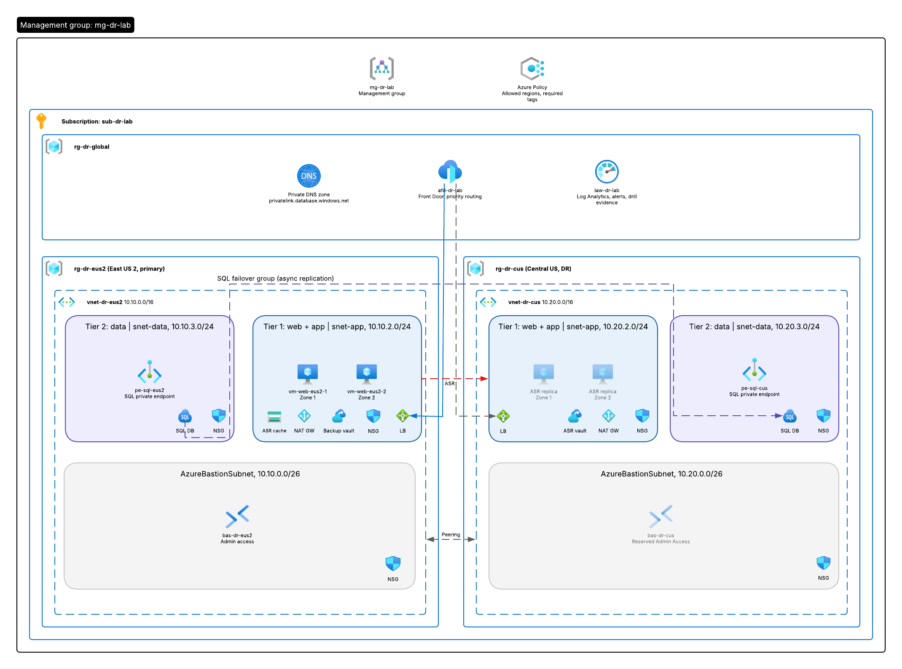

# two-tier-dr: Azure Multi-Region Disaster Recovery Lab
 
I built a two-tier web application across two Azure regions, entirely in Terraform, to practice designing, deploying, and testing cross-region disaster recovery.
 
East US 2 serves all traffic. Central US stays warm: its network, load balancer, and SQL server are always running, while the web VMs exist only as continuously replicated disks until a failover brings them online.
 
**Full step-by-step walkthrough:** [docs/LAB-GUIDE.md](docs/LAB-GUIDE.md)
 

 
---
 
## Objective
 
Design a two-tier application that survives three levels of failure, and prove each one with a test:
 
| Failure | Protection | How it recovers |
|---|---|---|
| A single VM fails | Load balancer health probe | Traffic shifts to the healthy VM |
| An availability zone fails | One web VM per zone, zone-redundant load balancer | The VM in the other zone keeps serving |
| The primary region fails | Site Recovery, SQL failover group, Front Door | Replicas boot in Central US, SQL fails over, Front Door shifts traffic |
 
Azure Backup covers a fourth case that failover cannot: deletion, corruption, or ransomware. Site Recovery copies that damage to the DR region within minutes, so backups keep clean copies from before it happened.
 
### Skills demonstrated
 
- Multi-region and zone-redundant Azure architecture
- Azure Site Recovery VM replication and recovery plans
- Azure SQL failover groups with private endpoints and private DNS
- Azure Front Door priority routing with health probes
- Azure Backup with geo-redundant storage and Cross Region Restore
- Least-privilege NSG design that blocks lateral movement
- Terraform modules, split state, and OIDC-authenticated CI/CD
---
 
## Project status
 
| Area | Status |
|---|---|
| Architecture design | Complete |
| Terraform modules and stacks | Complete, `terraform validate` passing |
| `terraform plan` | Passing for global, primary-eus2, and dr-cus |
| Terraform state backend and pipeline identity | Deployed |
| Global stack | Deployed |
| Regional stacks and replication | Not yet deployed |
| Proof tests and failover drill | Pending |
| CI/CD pipeline against Azure | Pending verification |
 
---
 
## What I built
 
| Component | Purpose |
|---|---|
| `vnet-dr-eus2`, `vnet-dr-cus` | Matching networks in each region, `10.10.0.0/16` and `10.20.0.0/16`, globally peered |
| `snet-app` | Tier 1: web VMs, reachable only through Front Door and the load balancer |
| `snet-data` | Tier 2: SQL private endpoint, reachable only from the app subnets |
| `AzureBastionSubnet` | Admin access with no public IPs on any VM |
| NSG per subnet | Explicit allows plus a final `DenyVnetInbound` that turns subnets into real boundaries |
| `vm-web-eus2-1`, `vm-web-eus2-2` | Web VMs in zones 1 and 2, configured by cloud-init |
| Standard load balancers | One per region. The DR one stays empty until failover. |
| NAT gateways | The only outbound path for private subnets |
| Azure SQL with failover group | Primary in East US 2, async replica in Central US, one listener name for the app |
| Private DNS zone | Resolves the SQL name to a private IP inside both VNets |
| Site Recovery | Continuous VM replication and a one-click recovery plan |
| Backup vault | Daily VM backups, geo-redundant, restorable in either region |
| Front Door | One public address, priority routing, automatic traffic shift on health failure |
| Azure Policy | Enforced allowed regions, audit-only required tags |
| Log Analytics | Central logs in Central US, so monitoring survives a primary outage |
 
---
 
## Proof of work
 
Each control is tested by trying to break it. Full procedures are in [Phase 10 of the lab guide](docs/LAB-GUIDE.md#phase-10-prove-it-works).
 
| Test | Expected | Result |
|---|---|---|
| Lateral movement between web VMs, deny rules removed, then restored by Terraform | Connects, then times out | Pending |
| SQL from inside the VNet | Resolves to `10.10.3.x`, port 1433 connects | Pending |
| SQL from the internet | Blocked: public network access disabled | Pending |
| Stop one web VM | Site stays up, served by the other zone | Pending |
| Regional failover drill | Site moves from `eastus2` to `centralus` | Pending |
 
### Recovery targets
 
Design targets. Measured values will be filled in after the failover drill.
 
| Tier | RPO target | RTO target | Measured RPO | Measured RTO |
|---|---|---|---|---|
| Web tier (Site Recovery) | 5 minutes | 30 minutes | Pending | Pending |
| Data tier (SQL failover group) | 1 minute | 15 minutes | Pending | Pending |
| End to end | 5 minutes | 60 minutes | Pending | Pending |
 
---
 
## Security design
 
**Network**
- No VM has a public IP. Web traffic arrives only through Front Door and the load balancer.
- The app NSG accepts HTTP only from the `AzureFrontDoor.Backend` service tag and SSH only from the Bastion subnet.
- The data NSG accepts SQL only from the app subnets.
- Every NSG ends with a deny rule that overrides Azure's built-in allow-all-VNet rule, which blocks lateral movement.
- Default outbound access is disabled. Outbound traffic leaves only through the NAT gateway.
**Data**
- Azure SQL has public network access disabled and uses Entra ID authentication only. No SQL passwords exist.
- SQL backups, VM backups, and Terraform state are all geo-redundant.
**Identity**
- CI/CD authenticates with OIDC workload identity federation. No client secrets are stored anywhere.
- Admins sign in to VMs with Entra ID through Bastion. The SSH key is break-glass only.
- Every role assignment is scoped to the smallest resource that needs it.
**Terraform state**
- Stored in its own resource group in Central US, geo-redundant, versioned, soft-delete protected, and locked against deletion.
### Lab versus production
 
| Setting | Lab | Production |
|---|---|---|
| Vault soft delete | Off, so `terraform destroy` works | On, plus immutable vaults and multi-user authorization |
| Front Door to origin | HTTP | HTTPS end to end, or Front Door Premium with Private Link |
| Origin lock-down | Service tag only | Service tag plus `X-Azure-FDID` header validation |
| Pipeline identity | One identity with Contributor | Separate read-only plan identity and approval-gated apply identity |
| Human access | Standing role assignments | Just-in-time access through Privileged Identity Management |
 
---
 
## Repository structure
 
```
two-tier-dr/
├── .github/workflows/ci.yml        # Calls the reusable Terraform pipeline per stack
├── bootstrap/create-tfstate.sh     # One-time state storage setup
├── docs/
│   ├── LAB-GUIDE.md                # Full phased walkthrough
│   ├── architecture/               # Diagrams
│   └── runbooks/                   # VM access, failover, failback
└── terraform/
    ├── keys/web.pub                # Break-glass SSH public key
    ├── modules/                    # Reusable building blocks
    │   ├── network/  compute/  sql/  backup/  site-recovery/  front-door/
    └── stacks/                     # Deployable units, one state file each
        ├── global/                 # DNS zone, Log Analytics, Azure Policy
        ├── primary-eus2/           # East US 2
        ├── dr-cus/                 # Central US
        └── dr-replication/         # Peering, failover group, Site Recovery, Front Door
```

 
