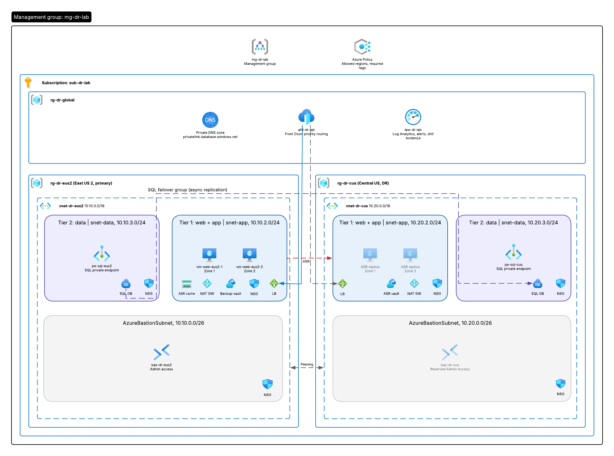
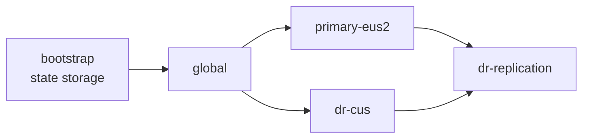

# Lab guide: Azure multi-region disaster recovery
 
This guide walks through building the two-tier-dr lab from an empty subscription, explaining what each phase builds and why, and ends by proving every protection works.
 
[Back to project overview](../README.md)
 
---
 
## 1. Objective
 
Build a two-tier web application in East US 2 with a warm standby in Central US, then prove it survives a VM failure, a zone failure, and a full regional failover.
 
By the end you will be able to:
 
- Split Terraform into reusable modules and independently deployed stacks
- Authenticate CI/CD to Azure with OIDC instead of stored secrets
- Explain how Azure evaluates NSG rules, and build a boundary that blocks lateral movement
- Connect to a PaaS database privately using a private endpoint and private DNS
- Explain the difference between Site Recovery and Azure Backup, and when each is used
- Run a regional failover and measure RTO and RPO
---
 
## 2. Architecture
 

 
Request flow:
 
1. Users connect to one Front Door address.
2. Front Door sends traffic to the healthy origin, preferring East US 2.
3. The load balancer spreads requests across web VMs in different availability zones.
4. Web VMs connect to SQL through the failover group's name, which the private DNS zone resolves to a private IP.
The lab is split into stacks that deploy in this order:
 

 
---
 
## 3. Prerequisites
 
- An Azure subscription where you have Owner
- Azure CLI, logged in with `az login`
- Terraform 1.6 or later
- A GitHub repository for the code
- GitHub CLI (optional, secrets can also be added in the browser)
---
 
## 4. Lab variables
 
| Item | Value |
|---|---|
| Primary region | East US 2 (`eus2`) |
| DR region | Central US (`cus`) |
| Primary VNet | `vnet-dr-eus2`, `10.10.0.0/16` |
| DR VNet | `vnet-dr-cus`, `10.20.0.0/16` |
| Bastion subnet | `x.x.0.0/26` |
| App subnet | `snet-app`, `x.x.2.0/24` |
| Data subnet | `snet-data`, `x.x.3.0/24` |
| Resource groups | `rg-tfstate`, `rg-dr-global`, `rg-dr-eus2`, `rg-dr-cus` |
| Web VMs | `vm-web-eus2-1` (zone 1), `vm-web-eus2-2` (zone 2) |
| Pipeline identity | `gh-two-tier-dr` |
| Management group | `mg-dr-lab` |
 
**Why the subnets skip `x.x.1.0`:** that range belonged to a management subnet that was removed from the design. Leaving the gap keeps the other ranges stable.
 
**Why the VNets must not overlap:** VNet peering fails if two address spaces overlap, and Site Recovery maps the primary network onto the DR network.
 
---
 
## Phase 0: Prepare the subscription
 
### Register resource providers
 
Azure must enable each service type on a subscription before you can create it.
 
```bash
for ns in Microsoft.Storage Microsoft.Network Microsoft.Compute Microsoft.Sql \
          Microsoft.RecoveryServices Microsoft.Cdn Microsoft.OperationalInsights Microsoft.Insights; do
  az provider register --namespace $ns
done
```
 
### Create the pipeline identity with OIDC
 
On each run, GitHub issues a signed token stating which repository and branch it is. Azure exchanges that token for a short-lived access token if it matches a federated credential. No password is ever stored.
 
```bash
SUB_ID=$(az account show --query id -o tsv)
TENANT_ID=$(az account show --query tenantId -o tsv)
APP_ID=$(az ad app create --display-name gh-two-tier-dr --query appId -o tsv)
az ad sp create --id $APP_ID
az role assignment create --assignee $APP_ID --role Contributor --scope /subscriptions/$SUB_ID
 
for s in "ref:refs/heads/main" "pull_request"; do
  az ad app federated-credential create --id $APP_ID --parameters "{
    \"name\": \"gh-${s//[:\/]/-}\",
    \"issuer\": \"https://token.actions.githubusercontent.com\",
    \"subject\": \"repo:clevelandjosiah/two-tier-dr:$s\",
    \"audiences\": [\"api://AzureADTokenExchange\"]
  }"
done
```
 
Create the GitHub repository first, then add three repository secrets: `AZURE_CLIENT_ID`, `AZURE_TENANT_ID`, and `AZURE_SUBSCRIPTION_ID`. These are identifiers, not passwords.
 
**Checkpoint:** `az ad app federated-credential list --id $APP_ID -o table` lists two credentials, and the repository shows three secrets.
 
---
 
## Phase 1: Terraform state backend
 
Every stack stores its state in an Azure storage account, but that account must exist before any stack can run. A one-time script creates it.
 
```bash
./bootstrap/create-tfstate.sh
```
 
The script is safe to re-run. It creates:
 
| Resource | Why |
|---|---|
| `rg-tfstate` | Separate from the lab, so tearing down the lab never deletes state |
| Storage account in Central US, geo-redundant | Terraform still works if East US 2 is down |
| `tfstate` container | One state file per stack |
| Versioning and 30-day soft delete | A corrupted state file can be rolled back |
| Storage Blob Data Contributor for the pipeline | The pipeline reads and writes state with Entra ID, not storage keys |
| `CanNotDelete` lock | Prevents accidental deletion |
 
Replace `sttfstateXXXXX` in every `backend.tf` and in `dr-replication/variables.tf` with the printed account name.
 
To run Terraform from your own machine, grant yourself data access too:
 
```bash
SA=$(az storage account list -g rg-tfstate --query "[0].name" -o tsv)
az role assignment create \
  --assignee $(az ad signed-in-user show --query id -o tsv) \
  --role "Storage Blob Data Contributor" \
  --scope $(az storage account show -n $SA -g rg-tfstate --query id -o tsv)
```
 
**Checkpoint:** `az storage container-rm exists --storage-account $SA -g rg-tfstate -n tfstate` returns `true`.
 
---
 
## Phase 2: Governance and access
 
### Management group and policy rights
 
Policies assigned to a management group are inherited by every subscription, resource group, and resource beneath it.
 
```bash
az account management-group create --name mg-dr-lab --display-name "mg-dr-lab"
az account management-group subscription add --name mg-dr-lab --subscription $SUB_ID
az role assignment create --assignee $APP_ID --role "Resource Policy Contributor" \
  --scope /providers/Microsoft.Management/managementGroups/mg-dr-lab
```
 
Contributor cannot assign policies, which is why the pipeline needs this separate role.
 
### VM sign-in with Entra ID
 
Admins sign in to VMs as their Entra ID account instead of with an SSH key. Access is controlled by a role.
 
```bash
az role assignment create \
  --assignee $(az ad signed-in-user show --query id -o tsv) \
  --role "Virtual Machine Administrator Login" \
  --scope /subscriptions/$SUB_ID
```
 
Azure still requires an SSH key to create a Linux VM, so generate one as a break-glass credential:
 
```bash
mkdir -p terraform/keys
ssh-keygen -t rsa -b 4096 -f ~/.ssh/two-tier-dr -N ""
cp ~/.ssh/two-tier-dr.pub terraform/keys/web.pub
```
 
Commit only the `.pub` file. The private key stays in `~/.ssh`.
 
**Checkpoint:** `az account management-group show --name mg-dr-lab -o table` succeeds, and `terraform/keys/web.pub` starts with `ssh-rsa`.
 
---
 
## Phase 3: Global stack
 
`terraform/stacks/global` holds resources shared by both regions:
 
| Resource | Why |
|---|---|
| `rg-dr-global` in Central US | Global resources still need a home region, and Central US survives a primary outage |
| Private DNS zone `privatelink.database.windows.net` | Both SQL private endpoints register their records here |
| Log Analytics workspace | Central logs that survive a primary outage |
| Allowed locations policy, enforced | Blocks resources outside the two lab regions |
| Required `project` tag policy, audit only | Reports untagged resources without blocking them |
 
**Why the tag policy only audits:** Site Recovery and private endpoints create resources behind the scenes without your tags. An enforced tag policy could block your own failover in the middle of an outage.
 
**Policy definitions versus assignments:** this lab writes no policy rules. Azure ships built-in definitions. The stack only creates assignments, which apply a built-in definition to a scope with your parameters.
 
```bash
export ARM_SUBSCRIPTION_ID=$(az account show --query id -o tsv)
cd terraform/stacks/global
terraform init
terraform plan
terraform apply
```
 
The global stack must be applied before the regional stacks, because they look up the DNS zone by name.
 
**Checkpoint:** `az network private-dns zone show -g rg-dr-global -n privatelink.database.windows.net -o table` succeeds.
 
---
 
## How Azure NSGs actually decide
 
Read this before Phase 4. It explains why every NSG in this lab ends with a deny rule.
 
Every NSG has built-in rules you cannot delete:
 
| Priority | Name | Effect |
|---|---|---|
| 65000 | `AllowVnetInBound` | Allows all traffic between anything in the VNet, including peered VNets, on any port |
| 65001 | `AllowAzureLoadBalancerInBound` | Allows load balancer health probes |
| 65500 | `DenyAllInBound` | Denies everything else |
 
Rules are evaluated from the lowest priority number, and the first match wins. Without custom rules, any VM in the VNet can reach any other VM on any port. If an attacker compromises one web server, nothing stops them from moving to the next.
 
Adding an allow rule alone changes nothing, because that traffic was already allowed at 65000. A boundary only exists once you add a **deny**. This lab places `DenyVnetInbound` at priority 4000, above the built-in allow, so only the specific allows above it get through.
 
---
 
## Phase 4: Network module
 
`terraform/modules/network` builds a full region from one address range:
 
| Resource | Why |
|---|---|
| VNet and three subnets | Ranges are calculated from the VNet range with `cidrsubnet`, so one input sets all three |
| App NSG | HTTP from Front Door, probes from the load balancer, SSH from Bastion, SQL out to the data subnets, everything else in the VNet denied both ways |
| Data NSG | SQL only from the app subnets, everything else denied |
| Bastion NSG | Azure's required rule set. Missing any rule fails the Bastion deployment. |
| `default_outbound_access_enabled = false` | VMs get no implicit internet access |
| NAT gateway on the app subnet | The only outbound path, used for package installs and Site Recovery replication |
| `private_endpoint_network_policies = "Enabled"` on the data subnet | Without it, the NSG is ignored for the SQL endpoint |
| Bastion, Standard tier, optional | Off by default to save cost. Standard supports Entra ID sign-in from the CLI. |
 
`peer_address_space` adds the other region's ranges to the SQL rules, so the web tier can reach either region's database after a SQL-only failover.
 
**Why NAT is needed for Site Recovery:** the replication agent on each VM sends disk writes to a cache storage account through its public endpoint. With default outbound access turned off, the NAT gateway is the only way out. The traffic still stays on Microsoft's network.
 
**Checkpoint:** from `terraform/stacks/primary-eus2`, `terraform plan` succeeds.
 
---
 
## Phase 5: Compute module
 
`terraform/modules/compute` creates one load balancer per region and one web VM per availability zone it is given.
 
| Resource | Why |
|---|---|
| Public IP, zone-redundant | Front Door's target for this region. It survives a zone failure. |
| Load balancer, backend pool, probe, rule | Spreads port 80 across healthy VMs. `disable_outbound_snat` leaves outbound to the NAT gateway. |
| Network interface per VM | Private IP only |
| Ubuntu VM per zone | Pinned to its zone, SSH key login only, password login disabled |
| cloud-init | Installs Nginx and writes a page naming the VM and region that served it |
| `AADSSHLoginForLinux` extension and managed identity | Entra ID sign-in |
 
The VMs are created with `for_each` over the zone list. The primary passes `["1", "2"]`. The DR region passes `[]`, which creates the load balancer with an empty pool, ready for Site Recovery to fill.
 
**High availability versus disaster recovery:** zones protect against losing one datacenter inside a region. That is high availability. Disaster recovery protects against losing the whole region, which is the job of Phase 9.
 
**Checkpoint:** `terraform plan` in the primary stack adds two VMs and one load balancer.
 
---
 
## How private endpoints and private DNS work
 
Read this before Phase 6.
 
Azure SQL Database is a managed service. Microsoft runs it outside your VNet. A **private endpoint** brings a doorway to it into your network: a network interface in the data subnet with a private IP from that subnet's range.
 
The **private DNS zone** makes the app use that IP:
 
1. The app looks up `sql-dr-eus2-xxxx.database.windows.net`.
2. Azure DNS answers with an alias: `sql-dr-eus2-xxxx.privatelink.database.windows.net`.
3. The private DNS zone, linked to the VNet, holds an A record for that name pointing to the private IP, like `10.10.3.4`.
4. The app connects to the private IP. The endpoint forwards the traffic to the database over Private Link.
The private endpoint provides the IP. The zone maps the name to it. The VNet link lets the VNet read the zone. Lookups from outside a linked VNet follow the same alias but get the public IP, which is blocked because public access is disabled.
 
---
 
## Phase 6: SQL module
 
`terraform/modules/sql`:
 
| Resource | Why |
|---|---|
| SQL logical server | Holds the connection name, login rules, and network settings. Not a VM. |
| Database `sqldb-app`, S0 | The data and the compute that runs queries. Primary region only. |
| Private endpoint with DNS zone group | Gets the private IP and writes the A record |
| VNet link to the DNS zone | Lets this region's VNet resolve the private IP |
 
Security settings: `public_network_access_enabled = false`, minimum TLS 1.2, and Entra ID authentication only, so no SQL usernames or passwords exist.
 
In the DR region, `create_database = false`. The failover group creates the secondary database in Phase 9.
 
Set `sql_admin_login` and `sql_admin_object_id` in both regional stacks:
 
```bash
az ad signed-in-user show --query "{login:userPrincipalName, objectId:id}" -o table
```
 
**Checkpoint:** `terraform plan` adds the server, database, private endpoint, and VNet link.
 
---
 
## Phase 7: Backup module
 
`terraform/modules/backup`:
 
| Resource | Why |
|---|---|
| Recovery Services vault in East US 2 | A backup vault must be in the same region as the VMs it protects |
| Geo-redundant storage with Cross Region Restore | Backups can be restored in Central US if East US 2 is down |
| Daily policy, 7-day retention, 2-day instant restore | Recent snapshots stay local for fast restores |
| Protected item per VM | Fed from the compute module's output, so new VMs are protected automatically |
 
**Backup versus Site Recovery:** Site Recovery is the failover path. It copies every disk write to the DR region within minutes, which also means it copies deletions, corruption, and ransomware. Backup keeps clean copies going back days, so it is the recovery path for damage, not for region loss.
 
Now deploy the primary region:
 
```bash
cd terraform/stacks/primary-eus2
terraform init
terraform plan
terraform apply
```
 
**Checkpoint:** `az backup item list --vault-name rsv-backup-eus2 -g rg-dr-eus2 -o table` lists two VMs.
 
---
 
## Phase 8: DR region
 
`terraform/stacks/dr-cus` calls the same three modules with three changes:
 
| Input | Primary | DR |
|---|---|---|
| `address_space` | `10.10.0.0/16` | `10.20.0.0/16` |
| `zones` | `["1", "2"]` | `[]` |
| `create_database` | `true` | `false` |
 
That builds the same network, an idle load balancer, and a SQL server without a database. This is a warm standby: everything is ready, but the expensive parts only appear during a failover.
 
```bash
cd ../dr-cus
terraform init
terraform plan
terraform apply
```
 
**Checkpoint:** the DR load balancer exists with an empty backend pool, and the plan created no VMs.
 
---
 
## How Site Recovery works
 
Read this before Phase 9.
 
1. **Enable replication.** Site Recovery creates empty replica disks in Central US, installs the Mobility service extension on each VM, and copies every disk in full once.
2. **Continuous replication.** The agent captures every disk write and sends it through the NAT gateway to a cache storage account in East US 2. Site Recovery ships the data from there to the replica disks over Microsoft's network.
3. **Recovery points.** Crash-consistent points are taken about every 5 minutes, and app-consistent points every 4 hours. They are kept for 24 hours.
4. **Failover.** You choose a recovery point. Site Recovery builds VMs from the replica disks, places them in the mapped subnet and zone, and adds them to the DR load balancer.
5. **Reprotect and failback.** Replication reverses, then you fail back the same way.
The Site Recovery vault stores only configuration and the list of recovery points. The data lives in the replica disks.
 
---
 
## Phase 9: Site Recovery module
 
`terraform/modules/site-recovery` replicates the primary web VMs into Central US and defines how they fail over:
 
| Resource | Why |
|---|---|
| Recovery Services vault `rsv-asr-cus` in Central US | Holds the replication settings and recovery points. It lives in the target region, so it survives a primary outage. |
| Cache storage account in East US 2 | Each VM's agent sends disk writes here first. Locally redundant, since it holds data only briefly. |
| Fabrics, one per region | Site Recovery's model of each region |
| Protection containers, one per fabric | Group the protected VMs within each region |
| Replication policy | Keeps 24 hours of recovery points, with an app-consistent point every 4 hours |
| Container mapping | Pairs the East US 2 container with the Central US one under that policy |
| Network mapping | Maps `vnet-dr-eus2` to `vnet-dr-cus`, so failed-over VMs land in the right network |
| Replicated VM, one per web VM | Replicates the OS disk, keeps each VM in the same zone number, and adds it to the DR load balancer on failover |
| Recovery plan `rp-web-eus2-to-cus` | Fails over both web VMs in one action |
 
The module takes the primary VMs from the primary stack's `vms` output, which holds each VM's ID, network interface, and OS disk. The compute module names OS disks predictably, so they can be looked up.
 
**Checkpoint:** from `terraform/stacks/dr-replication`, `terraform validate` succeeds.
 
---
 
## Phase 10: Front Door module
 
`terraform/modules/front-door` gives users one address and moves traffic between regions:
 
| Resource | Why |
|---|---|
| Front Door profile, Standard tier | The global entry point at Microsoft's edge locations |
| Endpoint | The single public address users connect to |
| Origin group with a health probe | Checks each region every 30 seconds to decide whether it is healthy |
| Primary origin, priority 1 | The East US 2 load balancer, used whenever it is healthy |
| Secondary origin, priority 2 | The Central US load balancer, used only when the primary fails its health checks |
| Route | Sends all paths to the origin group and redirects HTTP to HTTPS |
 
Priority sets the preference, and health sets eligibility. In practice, Front Door routes to whichever region is live, preferring East US 2. The DR load balancer has no VMs until a failover, so it fails its health checks and gets no traffic until Site Recovery brings the replicas up.
 
**Front Door only moves traffic.** It does not bring the DR region online. Site Recovery and the SQL failover must finish first, and that gap is your RTO.
 
**Checkpoint:** `terraform validate` in `terraform/stacks/dr-replication` still succeeds.
 
---
 
## Phase 11: Replication stack
 
`terraform/stacks/dr-replication` reads both regional stacks' outputs through `terraform_remote_state`, then connects the regions:
 
| Resource | Why |
|---|---|
| VNet peering, both directions | Lets the web tier reach either region's database after a SQL-only failover |
| SQL failover group, manual policy | Creates the secondary database and gives the app one listener name that follows whichever server is primary |
| `module "site_recovery"` | Phase 9 |
| `module "front_door"` | Phase 10. Deployed here, not in the global stack, because it needs both regions' load balancer IPs. |
 
This stack can only be planned after the primary and DR stacks are applied, since their outputs don't exist until then.
 
```bash
cd ../dr-replication
terraform init
terraform plan
terraform apply
```
 
This apply takes the longest, since Site Recovery copies each disk in full first.
 
**Checkpoint:** open `terraform output app_url`. The page names a VM and `eastus2`. Refresh to see it alternate between VMs. In the portal, `rsv-asr-cus` shows both VMs as Protected.
 
---
 
## Phase 12: Prove it works
 
Each test tries to break a control. Record results and save screenshots in `docs/evidence/`.
 
To get a shell on a web VM, set `deploy_bastion = true` in the primary stack, apply, then follow [runbooks/vm-access.md](runbooks/vm-access.md). Find VM IPs with `az vm list-ip-addresses -g rg-dr-eus2 -o table`.
 
### Test 1: Lateral movement is blocked
 
From `vm-web-eus2-2`, try to reach `vm-web-eus2-1` on SSH:
 
```bash
nc -zv -w 5 <vm-web-eus2-1 IP> 22
```
 
Expected: **times out**. The deny rules drop it.
 
Now remove the deny rules to show what they prevent:
 
```bash
az network nsg rule delete -g rg-dr-eus2 --nsg-name nsg-app-eus2 -n DenyVnetInbound
az network nsg rule delete -g rg-dr-eus2 --nsg-name nsg-app-eus2 -n DenyVnetOutbound
```
 
Run the same `nc` command. Expected: **succeeded**, because the built-in `AllowVnetInBound` now matches.
 
Restore the rules with Terraform:
 
```bash
cd terraform/stacks/primary-eus2
terraform plan
terraform apply
```
 
The plan detects the deleted rules as drift and puts them back. Run `nc` once more. Expected: **times out**.
 
| Step | Expected | Result |
|---|---|---|
| Deny rules in place | Times out | Pending |
| Deny rules deleted | Succeeded | Pending |
| Restored by Terraform | Times out | Pending |
 
**Timed out versus refused:** a timeout means the packet was silently dropped. "Connection refused" means it arrived and nothing was listening. Firewalls drop on purpose, so a scanner learns nothing.
 
### Test 2: SQL is private
 
From a web VM:
 
```bash
nslookup <primary SQL server name>.database.windows.net
nc -zv -w 5 <primary SQL server name>.database.windows.net 1433
```
 
Expected: the lookup shows the `privatelink` alias and a `10.10.3.x` address, and the connection **succeeds**.
 
From your laptop, open the database in the portal's Query editor. Expected: **denied**, with an error that public network access is disabled.
 
| Check | Expected | Result |
|---|---|---|
| Lookup from VM | `10.10.3.x` | Pending |
| Port 1433 from VM | Succeeded | Pending |
| Query editor from internet | Denied | Pending |
 
### Test 3: Zone failure
 
```bash
az vm stop -g rg-dr-eus2 -n vm-web-eus2-1
```
 
Refresh `app_url` for a minute. Expected: the site stays up, always served by `vm-web-eus2-2`. Restart with `az vm start -g rg-dr-eus2 -n vm-web-eus2-1`.
 
| Check | Expected | Result |
|---|---|---|
| Site with one VM stopped | Still up, served by zone 2 | Pending |
 
### Test 4: Regional failover drill
 
1. Record the start time.
2. In the portal, open `rsv-asr-cus`, then Recovery Plans, then `rp-web-eus2-to-cus`, then Failover. Choose the latest recovery point. Record its timestamp.
3. Fail over SQL:
```bash
   az sql failover-group set-primary --name <failover group> --resource-group rg-dr-cus --server <DR SQL server>
```
4. Refresh `app_url` until the page shows `centralus`. Record the end time.
5. RTO is end time minus start time. RPO is start time minus the recovery point timestamp.
| Measure | Target | Result |
|---|---|---|
| Web tier RTO | 30 minutes | Pending |
| Web tier RPO | 5 minutes | Pending |
| SQL failover time | 15 minutes | Pending |
 
To fail back: commit the failover and reprotect in `rsv-asr-cus`, fail the recovery plan back once replication is healthy, then run `set-primary` against the East US 2 server.
 
After failing over, the VMs in Central US are not backed up, since the East US 2 vault cannot protect them. Enable backup for them until failback.
 
---
 
## Troubleshooting
 
Real issues hit while building this lab.
 
**`SubscriptionNotFound` when creating the storage account, even though the subscription is listed and enabled.**
The `Microsoft.Storage` resource provider was not registered. Run `az provider register --namespace Microsoft.Storage --wait`.
 
**`failed to fetch public key: HTTP 404` from `gh secret set`.**
The GitHub repository did not exist yet. Secrets can only be added to an existing repository. Create it with `gh repo create`.
 
**The terminal shows `quote>` after pasting commands.**
zsh does not treat `#` as a comment when pasting, so an apostrophe in a comment opened a quote. Press Ctrl+C and paste without comments, or run `setopt interactivecomments`.
 
**`Backend configuration changed` on `terraform plan`.**
`backend.tf` was edited after the last `init`. If the stack was already applied, use `terraform init -migrate-state`. Using `-reconfigure` would forget the existing resources and try to recreate them.
 
**`no file exists at "./../../keys/web.pub"`.**
The SSH key was never generated on this machine. Run the `ssh-keygen` commands in Phase 2.
 
**`Reference to undeclared module`.**
The stack referenced `module.compute`, but the `module "compute"` block was missing from that stack's `main.tf`.
 
**`terraform init` fails with a 403 on your own machine.**
Your account needs Storage Blob Data Contributor on the state account. The pipeline has its own assignment, but you need one too.
 
**The editor underlines code in red, but `terraform validate` passes.**
The editor had not loaded the provider schema. Run `terraform init` in that folder, or reload the editor.
 
**`terraform plan` in dr-replication fails with "Unsupported attribute".**
Expected until the regional stacks are applied. This stack reads their outputs, which do not exist before deployment.
 
**`git push` rejected with "fetch first".**
The remote branch had a commit that was not local. Run `git pull --rebase`, then push. Never force push.
 
**A commit only included one folder.**
`git add .` was run inside a stack folder, so only that folder was staged. Run Git commands from the repository root: `cd "$(git rev-parse --show-toplevel)"`.
 
**Entra ID sign-in fails on a failed-over VM.**
Site Recovery may not carry over the managed identity. Re-enable it on the VM, or use the break-glass SSH key.
 
---
 
## Clean up
 
Destroy in reverse order. Only destroy from a failed-back state, or after cleaning up a test failover, since VMs created by Site Recovery are not in Terraform state and will block deleting the DR resource group.
 
```bash
cd terraform/stacks/dr-replication && terraform destroy
cd ../dr-cus && terraform destroy
cd ../primary-eus2 && terraform destroy
cd ../global && terraform destroy
```
 
The vaults have soft delete turned off, and the primary stack's provider is set to purge protected items, so the vaults delete cleanly. In production, both protections stay on.
 
Keep `rg-tfstate`, the pipeline identity, and the management group between sessions. Check Cost Management the next day to confirm charges stopped.
 
---
 
## What I built
 
See the [component table in the README](../README.md#what-i-built).
 
